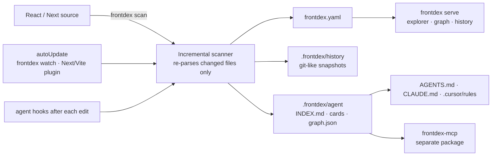

# frontdex

A living knowledge base for frontends (React, Next.js, Remix, TanStack, Vue, Nuxt, Svelte, SvelteKit, Astro, Angular, Web Components and plain HTML), like Swagger/OpenAPI for your UI. It scans the source and keeps two views of the same knowledge up to date:

- **For developers:** `frontdex.yaml` (the [CatalogueSpec](docs/SPEC.md) format) plus a page-first UI:
  - **Navigation:** URL → layouts → component → its state, props, functions, timers, API calls, global state, validation and styles. Every item links to its `file:line`.
  - **Diagnostics:** memory leaks, render loops, unsafe async updates, stale dependencies, and dead code.
- **For coding agents:** `.frontdex/agent/` (compact Markdown cards and a JSON graph), an MCP server, always-on rules and hooks for Claude Code, Cursor, OpenCode, Hermes, Copilot and anything that reads `AGENTS.md`.



## Quick start

```bash
npm install --save-dev frontdex       # or: pnpm add -D / yarn add -D / bun add -d
npx frontdex init --auto-update        # writes frontdex.config.json
npx frontdex scan                      # builds the knowledge base
npx frontdex agents                    # wires coding agents (rules, MCP, hooks)
npx frontdex serve                     # UI at http://localhost:4400
```

Until it is published on npm: `npm install --save-dev github:Prathmesh2000/frontdex`. The CLI also answers to `fdx` and, for existing setups, `rcat`.

### Coming from react-catalogue

frontdex is the new name of react-catalogue. A project with `catalogue.config.json`, `catalogue.yaml` or `.catalogue/` keeps working under those names. To switch:

```bash
npx frontdex upgrade   # catalogue.config.json → frontdex.config.json, catalogue.yaml → frontdex.yaml, .catalogue/ → .frontdex/
npx frontdex agents    # replaces the react-catalogue rules block, MCP entry, hooks and Cursor rule
```

`require('react-catalogue/next').withCatalogue` is still exported from `frontdex/next` as `withCatalogue`.

## Commands

| Command | What it does |
|---|---|
| `frontdex init [--auto-update]` | Creates `frontdex.config.json`. |
| `frontdex doctor` | What was detected (config, frameworks, workspaces, package manager, files, compilers, routers, agents, git) and how to fix what is missing. |
| `frontdex fix [--tokens] [--dry-run]` | Safe automatic fixes: removes unused imports; with `--tokens`, replaces stylesheet literals that exactly equal a CSS token by `var(--token)`. Near matches are left for review. |
| `frontdex scan [--full] [-m msg]` | Incremental rescan: unchanged files (same mtime/size or content hash) reuse their cached parse. `--full` ignores the cache. Records a history snapshot when anything changed. |
| `frontdex watch` | Keeps everything updated while you code. This is what `autoUpdate` runs. |
| `frontdex check` | Exits 1 if the catalogue is stale. Use in CI or a pre-commit hook. |
| `frontdex diff [base] [head]` / `frontdex pr-comment [base]` | Frontend impact of a change between git refs (text, `--json`, `--markdown`); see [Pull requests and CI](#pull-requests-and-ci). |
| `frontdex history [id] [-n 20]` | Log of knowledge-base snapshots; pass an id for the full change list. |
| `frontdex serve` / `frontdex start` | UI server. Auto-updates and live-reloads when `autoUpdate` is on (or with `-w`). |
| `frontdex build [-o dir]` | Static export of the UI, history included. |
| `frontdex query "<filters>"` | Search from the terminal, e.g. `frontdex query "uses:Button is:shared"`. |
| `frontdex show <Component>` / `frontdex impact <Component>` | Component card / everything that depends on it. |
| `frontdex dataflow <Component>` | Props in (per parent, with values) → store reads → state/effects → API calls, dispatches → props out. |
| `frontdex health [type] [--severity high] [--strict]` | Leaks, render loops, async/unmount bugs, stale deps, dead code. `--strict` exits 1 on high-severity issues (CI). |
| `frontdex state [store]` / `frontdex api [endpoint]` | Global state map with readers/writers; every API call grouped by endpoint. |
| `frontdex find <Name> [--props a,b]` | Existing components similar to one you are about to create (base name, name words, props). |
| `frontdex dupes [Component]` | Components that look like duplicates: same or similar names, shared props, children and classes. |
| `frontdex tokens [query]` | Design tokens (CSS custom properties, Tailwind theme) and hard-coded values that match them exactly or nearly. |
| `frontdex hooks [name]` | Custom hooks: where each is defined, what it reads and calls, which components use it. |
| `frontdex owners <Component>` | CODEOWNERS, test and story files, and live git activity (last change, commits in 90 days, top authors). |
| `frontdex adoption <Component>` | How many components and pages use it in each knowledge-base snapshot, e.g. to watch a deprecated component go away. |
| `frontdex agents [--targets …] [--no-hooks] [--no-mcp] [--remove]` | Installs or removes agent integration. |
| `frontdex mcp` | MCP server over stdio (registered automatically by `frontdex agents`). |
| `frontdex validate [file]` | Validates against the JSON Schema. |

All commands accept `-C <dir>` to target another project, and `--json` for machine-readable output (query commands, `scan`, `check`, `history`, `diff`, `doctor`).

## Auto-update

With `"autoUpdate": true`, `frontdex serve` watches the source. To keep the knowledge base current while your normal dev server runs, use one of:

```js
// next.config.js: runs `frontdex watch` next to `next dev`, stops with it
const { withFrontdex } = require('frontdex/next');
module.exports = withFrontdex({ reactStrictMode: true });
```

```js
// vite.config.js: also serves the catalogue UI on the dev server at /__frontdex/
import frontdex from 'frontdex/vite';
export default { plugins: [react(), frontdex()] };
```

```js
// webpack.config.js or rspack.config.js: runs while webpack-dev-server / `rspack dev` / --watch runs
const FrontdexPlugin = require('frontdex/webpack'); // same plugin as 'frontdex/rspack'
module.exports = { plugins: [new FrontdexPlugin()] };
```

### Live component preview (Vite + React)

With the Vite plugin, every component page in the catalogue UI (`/__frontdex/`) gets a **Live preview**: the component rendered by your own dev server (its imports, CSS and HMR), with a JSON props editor seeded from its first story's args. Components that need providers (router, theme, store, data) render through a wrapper you point to:

```jsonc
// frontdex.config.json
{ "previewWrapper": "src/frontdex.preview.tsx" }   // default export: ({ children }) => <Providers>{children}</Providers>
```

The preview page is `/__frontdex/preview?id=<component id>`; it takes props only by `postMessage` from the catalogue UI that embeds it, never from its URL (a link could otherwise inject markup). Agents can load it with a browser tool (Playwright, Chrome DevTools MCP) to look at or screenshot a component. Next.js gets the page-level Preview tab only: a component route there would end up in `next build`.

### Component overlay (React, development only)

Hold **Alt** and hover any element of your running app: frontdex outlines the component that rendered it and shows its name, `file:line` and props. **Alt+click** opens it in the catalogue UI.

```js
// Vite: injected for you
frontdex({ overlay: true })

// Next.js / webpack / Rspack: in any client component (keep the NODE_ENV guard, it keeps it out of production)
if (process.env.NODE_ENV === 'development') import('frontdex/overlay');
```

Outside Vite the overlay talks to `frontdex serve` on `http://localhost:4400`; set `window.__FRONTDEX_URL__` before it loads to point elsewhere. Names come from React, so they need a development build (minified production names cannot be matched). Render counts are not shown.

None of them add anything to a production build: the Vite plugin applies to `serve` only, the webpack/Rspack plugin acts only in watch mode, and the Next wrapper only in `next dev`.

or `"dev": "frontdex watch & next dev"` in `package.json`. A burst of saves (250 ms debounce) is patched in at once: only the edited files are re-parsed and their components re-linked. Project-wide findings (duplicates, token drift, page lists, dead code) and the YAML, agent cards and history follow with a full scan once edits pause for 1.5 s; the UI shows "analysing…" until then. Renaming a component or adding or removing a file goes straight to the full scan. A file that is broken mid-edit keeps its last good version instead of disappearing.

## History

Every scan that changes the catalogue records a snapshot, like a commit: id, time, git HEAD, message and a field-level change list (`ProductCard props +size`, `Header state −query`, `page /checkout added`). Line-number shifts are ignored. Objects are content-addressed and packed per snapshot, so unchanged components cost nothing.

- **CLI:** `frontdex history`, `frontdex history <id>`
- **UI:** the **History** page and the **History** tab on each component
- **Agents:** the `catalogue_history` MCP tool

History lives in `.frontdex/history/`, which is git-ignored by default. Remove `history/` from `.frontdex/.gitignore` to share it.

## Pull requests and CI

`frontdex diff [base] [head]` reports what a change does to the frontend: components, pages and endpoints added, removed or changed (field by field), the pages each change reaches through everything that renders it, and the issues, duplicates and token drift it introduces. `base` defaults to `HEAD`, `head` to the working tree. A ref's catalogue is read from the `frontdex.yaml` committed at that ref, or scanned in a temporary git worktree when there is none (`--scan` forces scanning).

```bash
npx frontdex diff                 # working tree vs last commit
npx frontdex diff origin/main     # this branch vs main
npx frontdex diff v1.2 v1.3 --json
npx frontdex diff origin/main --fail-on high   # exit 1 when new high-severity issues appear
```

The GitHub Action posts the same report as one PR comment, updated on every push, and adds it to the job summary:

```yaml
# .github/workflows/frontdex.yml
on: pull_request
permissions:
  contents: read
  pull-requests: write
jobs:
  frontdex:
    runs-on: ubuntu-latest
    steps:
      - uses: actions/checkout@v4
        with: { fetch-depth: 0 }
      - uses: actions/setup-node@v4
        with: { node-version: 22, cache: npm }
      - run: npm ci
      - uses: Prathmesh2000/frontdex/integrations/github-action@main
        with:
          fail-on: high        # optional
          # working-directory: apps/web
```

A comment looks like: **~2 components · 3 page(s) affected · 1 new issue**, then a table of changed components (what changed, pages reached, dependents), route and endpoint changes, and collapsible sections for new issues and design-system findings.

## Coding agents

`frontdex agents` installs, idempotently and between `<!-- frontdex -->` markers so your own content is untouched:

| Agent | Rules (always loaded) | Tools | After-edit feedback |
|---|---|---|---|
| Claude Code | `AGENTS.md`, or an `@.frontdex/agent/RULES.md` import in an existing `CLAUDE.md` | `.mcp.json` | `PostToolUse` + `SessionStart` hooks in `.claude/settings.json` |
| Cursor | `.cursor/rules/frontdex.mdc` (`alwaysApply`) + `AGENTS.md` | `.cursor/mcp.json` | `postToolUse` + `sessionStart` in `.cursor/hooks.json` |
| OpenCode | `AGENTS.md` | `opencode.json` | – |
| Hermes | `AGENTS.md` (or an existing `.hermes.md`) | `~/.hermes/config.yaml` (user-level; snippet printed) | – |
| Copilot / others | `.github/copilot-instructions.md`, `AGENTS.md` | – | – |

The rules require agents to:
1. search before creating a component;
2. read a component's card before editing it;
3. check its impact before changing props or exports;
4. rescan afterwards.

The hooks make this hard to skip:
- After every file edit, the agent receives what changed and who is affected, e.g. `ProductGrid changed: props +title. Rendered by: Page. Pages: /`.
- `frontdex check` in CI fails a PR whose catalogue is stale.

The rules also tell agents to reuse existing stores, endpoints and CSS classes, and never to ship an effect without cleanup.

### MCP server

The MCP server is a separate package, [frontdex-mcp](https://github.com/Prathmesh2000/frontdex-mcp). Install it next to this one:

```bash
npm install --save-dev frontdex-mcp
```

The `.mcp.json` entry written by `frontdex agents` runs `npx frontdex mcp`, which starts frontdex-mcp from your project. Without it installed, `frontdex mcp` prints the install command. The tools behind it (`createTools`) are part of this package's public API and also power `frontdex query`, `show`, `impact`, `dataflow`, `health`, `state` and `api`.

## The UI

```
Site map ─ URL map (route → layouts → page component, API/state/issue counts) · "What to do next" · global state
 └─ Page /checkout ─ Structure tree · Data & APIs · live Preview (iframe of your dev server) · Health · Graph
     └─ Component ─ trail breadcrumb (/checkout › RootLayout › CheckoutLayout › CheckoutPage › CheckoutWizard)
         ├─ Data flow   inputs (parent props with values, store/context reads) → state → effects/handlers → API/dispatch/timers → children
         ├─ Family      every path from a page, parents + the props they pass, siblings, children + the props they receive
         ├─ Internals   state (and what updates it), props (and what each parent passes), variables, functions, hooks, refs
         ├─ Lifecycle   mount/update/unmount matrix, every timer/listener/subscription and whether it is released
         ├─ API & state endpoints, Redux/context/zustand reads & writes, validation rules
         ├─ Styles      class → defining file:line, CSS modules, stylesheets
         └─ Health · Source · History
Global state · Health (all issues, dead code, API map + server endpoints) · Design (tokens, drift, duplicates) · Hooks · Changes (diff vs a git ref) · Components explorer · Graph · History
```

- **Sidebar:** the same page-first tree. Expand a route into its layouts and components, and expand a component into its State / Props / Functions / Effects / Timers / API / Store / Issues.
- **Source:** every `file:line` opens the source in a side panel, and there's a VS Code button.
- **Rescan:** the top bar has a Rescan button, and auto-update keeps the open tab live.
- **Search:** `Ctrl K` searches pages, components, stores, endpoints, folders and hooks.
- **Component header:** kind, client/server rendering, custom-element tag or styled element, CODEOWNERS, tests; the overview starts with usage examples from stories.
- **Two UIs:** `frontdex serve` opens the React UI at `/`, which loads everything page by page from the API below. The previous UI, which embeds the whole catalogue, stays at `/classic/`, and it is what `frontdex build` exports as a static site.
- **HTTP API** (while `frontdex serve` runs, localhost only): `/api/info`, `/api/components?q=&offset=&limit=` (paged, query language), `/api/component?id=` (old ids resolve through `aliases`), `/api/issues?severity=&offset=&limit=`, `/api/folders?path=`, `/api/graph?focus=&depth=&dir=`, `/api/section?name=tokens|duplicates|hooks|stores|endpoints|styles|health`, `/api/pages`, `/api/diff?base=&head=`, `/api/catalogue`, `/api/history`.

Query language (combine freely, prefix `-` to negate):

```
kind:class  hook:useEffect  prop:onClick  state:loading  ctx:Theme  uses:Button  in:Header
page:/checkout  dir:components/ui  ext:next/image  tag:forms  owner:web-core
api:/orders  store:cart  issue:memory-leak  timer:interval  class:btn  var:total  fn:handleSubmit
has:state|props|effects|context|refs|children|docs|api|store|validation|issues|leaks|timers
is:unused|shared|heavy|page|layout|leaf|deprecated|undocumented|leaky
```

## Configuration

`frontdex.config.json` (every key optional):

```json
{
  "title": "shop-web",
  "include": ["."],
  "exclude": ["**/node_modules/**", "**/.next/**", "**/*.test.*", "**/*.stories.*"],
  "output": "frontdex.yaml",
  "port": 4400,
  "preview": "http://localhost:3000",
  "autoUpdate": true,
  "knowledgeDir": ".frontdex",
  "history": { "enabled": true, "limit": 500 },
  "agents": { "enabled": true },
  "workspaces": ["apps/*", "packages/*"]
}
```

`preview` is where your dev server runs, for the live Preview tab. The default is `:3000` for Next, `:5173` for Vite. `tsconfig.json` / `jsconfig.json` path aliases are resolved automatically, using the config nearest to each file and following `extends`. `workspaces` is only needed to override detection (see Monorepos).

### Monorepos

Workspaces are read from `package.json` `workspaces` (npm, Yarn, Bun), `pnpm-workspace.yaml` or `lerna.json`; nx and Turborepo repos use one of these. Run frontdex from the repo root:

- An import of a workspace package (`@acme/ui`, `@acme/ui/card`) resolves to that package's source, through its `exports` map, `source`/`module`/`main` fields, or `src/` when those point at `dist/`.
- Every workspace that depends on `next` contributes its `app/` and `pages/` routes. Components and pages carry a `workspace` field. When two apps serve the same URL, the second is keyed `"/ (@acme/admin)"`.
- `info.packageManager` records npm, pnpm, yarn, yarn-berry, yarn-pnp or bun. Nothing is resolved through `node_modules`, so Yarn Plug'n'Play needs no extra setup.

## Files it creates

```
frontdex.yaml                 human spec: commit it, review it, hand-edit description/tags/owner/x-*
.frontdex/
  agent/INDEX.md               agent entry point: rules, pages, folders, shared components (commit it)
  agent/components/<dir>.md    one card per component, mirroring the source folder
  agent/graph.json             machine-readable graph
  agent/RULES.md               rules imported by CLAUDE.md
  history/                     snapshots (git-ignored by default)
  cache/                       incremental-scan cache (git-ignored)
```

## What gets detected

| Area | Supported |
|---|---|
| Components | function declarations, arrow functions, default exports (named or anonymous), `memo`, `forwardRef`, class components, Qwik `component$` |
| Vue | `.vue` single-file components via the project's own `vue/compiler-sfc`: `<script setup>` (`defineProps` type or runtime form, `withDefaults`, `ref`/`reactive`/`computed`, lifecycle hooks, `watch`, composables, `fetch`/`$fetch`/`useFetch`) and the Options API (`props`, `data`, lifecycle, `components`); template children with their props, listeners and `v-model`; static classes. Vue Router route objects (including lazy `() => import()`), Nuxt `pages/` with `app.vue` and `layouts/default.vue` |
| Svelte | `.svelte` components via the project's own `svelte/compiler`: Svelte 5 runes (`$props` with types and defaults, `$state`, `$derived`, `$effect` with cleanup) and Svelte 4 (`export let`, top-level `let`, `$:`, `onMount`/`onDestroy`); child components with props, `on:` events and `bind:`; static classes. SvelteKit `+page`/`+layout` routes, `+server.ts` handlers, `+page.server.ts` form actions, the `$lib` alias |
| Astro | `.astro` via the project's own `@astrojs/compiler`: frontmatter imports, `Astro.props` typed by `interface Props`, frontmatter fetches; child components and framework islands (React/Vue/Svelte components with `client:*` kept as props); `src/pages` routes and `.ts` endpoints |
| Angular | `@Component` classes: element `selector` (used to link `<app-x>` in templates), `@Input`/`@Output`, signal `input()`/`input.required()`/`model()`/`output()`, `signal()`/`computed()` state, lifecycle hooks, `HttpClient` calls, inline `template` or `templateUrl`; Angular Router `Routes` with `component` and `loadComponent` |
| Web Components | Classes extending `HTMLElement`, `LitElement`, `FASTElement` and similar, registered with `customElements.define` or `@customElement`: Lit `static properties` / `@property` / `@state`, `observedAttributes`, lifecycle callbacks, child elements in `html` templates. `<x-tag>` anywhere resolves to its definition |
| Plain HTML | In projects without a JS framework (or with `"html": true`): every `.html` file is a page; custom elements, `<script src>` (linked as imports), stylesheets (classes resolve), htmx `hx-*` and forms as API calls, Alpine `x-data` state and named components, Stimulus controllers |
| Props | TS param types, `FC<Props>`, `forwardRef<Ref, Props>`, interfaces with `extends`, intersections, `PropsWithChildren`, destructuring defaults, `propTypes`, `defaultProps`, `props.x` usage |
| State | `useState`, `useReducer`, class `state` / `this.state`, Solid `createSignal`/`createStore`/`createMemo`, Qwik `useSignal`/`useStore`/`useComputed$` |
| Lifecycle | effect hooks (deps → mount/update, cleanup → unmount) and all class lifecycle methods, with the functions each one calls |
| Routing | Next.js App Router (groups, parallel slots, dynamic segments, nested layouts), Pages Router (`_app`), React Router JSX and object routes, React Router v7 framework mode (`app/routes.ts`, `flatRoutes()`), Remix v2 flat routes, TanStack Router file routes, Gatsby, SolidStart, Qwik City |
| Server side | Next.js route handlers (with their HTTP methods), Pages Router API routes, middleware, server actions (and who imports them), Remix/React Router resource routes, page `metadata`, and each App Router component's client/server rendering |
| Imports | relative paths, tsconfig aliases (per-folder configs, `extends`), workspace packages, barrels, namespace imports, `lazy()` / `next/dynamic`, compound components (`<Tabs.List>`, `Card.Header = …`, `Object.assign`) |
| Global state | Redux Toolkit (`createSlice`, `configureStore`, thunks, `useSelector`/`useAppSelector`, `dispatch`, `connect`), React context (incl. through custom hooks), zustand |
| Data & validation | `fetch`, axios-style clients, SWR, React Query, service modules; zod, yup, react-hook-form, HTML constraints, custom validators |
| Styles | `className` strings, template literals, `clsx`/`cn`, CSS modules, global stylesheets (class → `file:line`), Tailwind utilities resolved to theme tokens (`md:bg-brand-500` → `colors.brand.500`), styled-components / Emotion (`styled.button`, `styled(Base)`, object styles; kind `styled`) |
| Diagnostics | memory leaks, render loops, side effects in render, unsafe async updates, missing deps, unused variables/functions/props/state/imports/exports/files/components, deprecated usage, hooks or class components rendered as Server Components, heavy imports in client code (moment, lodash CJS, chart.js/auto, aws-sdk v2, …, with lighter alternatives) |
| Accessibility | Static checks in JSX, Vue, Svelte, Astro and Angular templates and HTML pages: images without `alt`, buttons/links without text or `aria-label`, form fields without a label (wrapping `<label>`, `id`, `aria-label`), click handlers on non-interactive elements without role/keyboard support, positive `tabIndex`, `<html>` without `lang` |
| Ownership and tests | `CODEOWNERS` owners per component; test (`.test`/`.spec`, `__tests__/`) and story files next to it; stories (CSF, incl. CSF2 `X.args`) read as usage examples with their args. Git activity is read live by `frontdex owners` and never stored |
| i18n | Hard-coded text and copy attributes (`placeholder`, `title`, `alt`, `aria-label`) in JSX, reported only when the project uses an i18n library (react-i18next, next-intl, react-intl, Lingui, vue-i18n, …) |
| Design system | Near-duplicate components (scored on base name, name words, props, children and classes); design tokens from CSS custom properties, Tailwind v4 `@theme`, Tailwind JS config and JS theme objects (`const theme = {…}`, `createTheme`), with usage counts; hard-coded colors (exact or within a small RGB distance) and sizes that match a token, in stylesheets, styled-components/Emotion CSS and Tailwind arbitrary values (`bg-[#3b82f6]`) |

## Performance

Measured with `node bench/scan.js 250`: the Next sample copied 250 times into one repo, 22,500 files and 19,500 components, full deep analysis. Node 24, Windows, 4-core laptop with Defender scanning the fresh copies.

| Operation | Time |
|---|---|
| Cold scan | 80–100 s (3.5–4.5 ms per file; parsing runs on worker threads) |
| No-change rescan (CLI) | 11–13 s |
| Save while `watch` / `serve -w` runs | **~130 ms** to show the edit |
| Project-wide findings after a save | settle ~2.8 s after edits pause |
| Peak RSS (uncapped) | 1.8–2.6 GB; the scan completes with `--max-old-space-size=1024`, more slowly |

At 1,800 files: cold scan about 7 s, a save shows up in under 20 ms. The UI pages its data from the server, so it stays responsive at 20k components.

## Samples

| Sample | Contents |
|---|---|
| [examples/next-app](examples/next-app) "Northwind Shop" | Next.js App Router: storefront, checkout, account and admin; Redux Toolkit, contexts, zustand, axios, SWR, zod, react-hook-form, CSS modules |
| [examples/react-app](examples/react-app) "Acme Admin" | React Router `createBrowserRouter`, Redux + `connect`, yup, class components with every lifecycle method |
| [examples/monorepo](examples/monorepo) | pnpm workspace: a Next app and a Vite + React Router app sharing `@acme/ui` (exports map pointing at `dist/`), tsconfig `extends` + `paths` |

Both samples contain deliberate memory leaks, a render loop, stale dependencies and dead code, each marked `// demo:`, so every catalogue feature has something to show.

## Development

```bash
npm install && npm test
node bin/frontdex.js serve -C examples/next-app -w
```

## Limits

Static analysis only: components produced by factories and routes built from runtime data are not followed. Vue: Nuxt auto-imported components (used without an import) and Pinia stores are not linked yet. Svelte stores (`$store`) are not linked yet. Leak/render-loop diagnostics are React-only.
