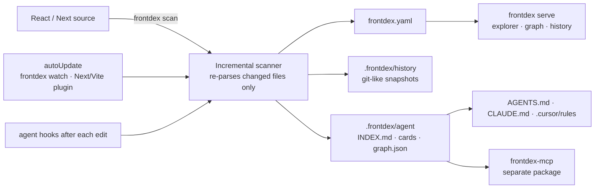

# frontdex

A living knowledge base for React and Next.js frontends, like Swagger/OpenAPI for your UI. It scans the source and keeps two views of the same knowledge up to date:

- **For developers:** `frontdex.yaml` (the [CatalogueSpec](docs/SPEC.md) format) plus a page-first UI:
  - **Navigation:** URL → layouts → component → its state, props, functions, timers, API calls, global state, validation and styles. Every item links to its `file:line`.
  - **Diagnostics:** memory leaks, render loops, unsafe async updates, stale dependencies, and dead code.
- **For coding agents:** `.frontdex/agent/` (compact Markdown cards and a JSON graph), an MCP server, always-on rules and hooks for Claude Code, Cursor, OpenCode, Hermes, Copilot and anything that reads `AGENTS.md`.



## Quick start

```bash
npm install --save-dev frontdex       # or: pnpm add -D / yarn add -D / bun add -d
npx frontdex init --auto-update        # writes frontdex.config.json
npx frontdex scan                      # builds the knowledge base
npx frontdex agents                    # wires coding agents (rules, MCP, hooks)
npx frontdex serve                     # UI at http://localhost:4400
```

Until it is published on npm: `npm install --save-dev github:Prathmesh2000/frontdex`. The CLI also answers to `fdx` and, for existing setups, `rcat`.

### Coming from react-catalogue

frontdex is the new name of react-catalogue. A project with `catalogue.config.json`, `catalogue.yaml` or `.catalogue/` keeps working under those names. To switch:

```bash
npx frontdex upgrade   # catalogue.config.json → frontdex.config.json, catalogue.yaml → frontdex.yaml, .catalogue/ → .frontdex/
npx frontdex agents    # replaces the react-catalogue rules block, MCP entry, hooks and Cursor rule
```

`require('react-catalogue/next').withCatalogue` is still exported from `frontdex/next` as `withCatalogue`.

## Commands

| Command | What it does |
|---|---|
| `frontdex init [--auto-update]` | Creates `frontdex.config.json`. |
| `frontdex scan [--full] [-m msg]` | Incremental rescan: unchanged files (same mtime/size or content hash) reuse their cached parse. `--full` ignores the cache. Records a history snapshot when anything changed. |
| `frontdex watch` | Keeps everything updated while you code. This is what `autoUpdate` runs. |
| `frontdex check` | Exits 1 if the catalogue is stale. Use in CI or a pre-commit hook. |
| `frontdex history [id] [-n 20]` | Log of knowledge-base snapshots; pass an id for the full change list. |
| `frontdex serve` / `frontdex start` | UI server. Auto-updates and live-reloads when `autoUpdate` is on (or with `-w`). |
| `frontdex build [-o dir]` | Static export of the UI, history included. |
| `frontdex query "<filters>"` | Search from the terminal, e.g. `frontdex query "uses:Button is:shared"`. |
| `frontdex show <Component>` / `frontdex impact <Component>` | Component card / everything that depends on it. |
| `frontdex dataflow <Component>` | Props in (per parent, with values) → store reads → state/effects → API calls, dispatches → props out. |
| `frontdex health [type] [--severity high] [--strict]` | Leaks, render loops, async/unmount bugs, stale deps, dead code. `--strict` exits 1 on high-severity issues (CI). |
| `frontdex state [store]` / `frontdex api [endpoint]` | Global state map with readers/writers; every API call grouped by endpoint. |
| `frontdex agents [--targets …] [--no-hooks] [--no-mcp] [--remove]` | Installs or removes agent integration. |
| `frontdex mcp` | MCP server over stdio (registered automatically by `frontdex agents`). |
| `frontdex validate [file]` | Validates against the JSON Schema. |

All commands accept `-C <dir>` to target another project.

## Auto-update

With `"autoUpdate": true`, `frontdex serve` watches the source. To keep the knowledge base current while your normal dev server runs, use one of:

```js
// next.config.js: runs `frontdex watch` next to `next dev`, stops with it
const { withFrontdex } = require('frontdex/next');
module.exports = withFrontdex({ reactStrictMode: true });
```

```js
// vite.config.js
import frontdex from 'frontdex/vite';
export default { plugins: [react(), frontdex()] };
```

or `"dev": "frontdex watch & next dev"` in `package.json`. A burst of saves triggers one scan (250 ms debounce). A file that is broken mid-edit keeps its last good version instead of disappearing.

## History

Every scan that changes the catalogue records a snapshot, like a commit: id, time, git HEAD, message and a field-level change list (`ProductCard props +size`, `Header state −query`, `page /checkout added`). Line-number shifts are ignored. Objects are content-addressed and packed per snapshot, so unchanged components cost nothing.

- **CLI:** `frontdex history`, `frontdex history <id>`
- **UI:** the **History** page and the **History** tab on each component
- **Agents:** the `catalogue_history` MCP tool

History lives in `.frontdex/history/`, which is git-ignored by default. Remove `history/` from `.frontdex/.gitignore` to share it.

## Coding agents

`frontdex agents` installs, idempotently and between `<!-- frontdex -->` markers so your own content is untouched:

| Agent | Rules (always loaded) | Tools | After-edit feedback |
|---|---|---|---|
| Claude Code | `AGENTS.md`, or an `@.frontdex/agent/RULES.md` import in an existing `CLAUDE.md` | `.mcp.json` | `PostToolUse` + `SessionStart` hooks in `.claude/settings.json` |
| Cursor | `.cursor/rules/frontdex.mdc` (`alwaysApply`) + `AGENTS.md` | `.cursor/mcp.json` | `postToolUse` + `sessionStart` in `.cursor/hooks.json` |
| OpenCode | `AGENTS.md` | `opencode.json` | – |
| Hermes | `AGENTS.md` (or an existing `.hermes.md`) | `~/.hermes/config.yaml` (user-level; snippet printed) | – |
| Copilot / others | `.github/copilot-instructions.md`, `AGENTS.md` | – | – |

The rules require agents to:
1. search before creating a component;
2. read a component's card before editing it;
3. check its impact before changing props or exports;
4. rescan afterwards.

The hooks make this hard to skip:
- After every file edit, the agent receives what changed and who is affected, e.g. `ProductGrid changed: props +title. Rendered by: Page. Pages: /`.
- `frontdex check` in CI fails a PR whose catalogue is stale.

The rules also tell agents to reuse existing stores, endpoints and CSS classes, and never to ship an effect without cleanup.

### MCP server

The MCP server is a separate package, [frontdex-mcp](https://github.com/Prathmesh2000/frontdex-mcp). Install it next to this one:

```bash
npm install --save-dev frontdex-mcp
```

The `.mcp.json` entry written by `frontdex agents` runs `npx frontdex mcp`, which starts frontdex-mcp from your project. Without it installed, `frontdex mcp` prints the install command. The tools behind it (`createTools`) are part of this package's public API and also power `frontdex query`, `show`, `impact`, `dataflow`, `health`, `state` and `api`.

## The UI

```
Site map ─ URL map (route → layouts → page component, API/state/issue counts) · "What to do next" · global state
 └─ Page /checkout ─ Structure tree · Data & APIs · live Preview (iframe of your dev server) · Health · Graph
     └─ Component ─ trail breadcrumb (/checkout › RootLayout › CheckoutLayout › CheckoutPage › CheckoutWizard)
         ├─ Data flow   inputs (parent props with values, store/context reads) → state → effects/handlers → API/dispatch/timers → children
         ├─ Family      every path from a page, parents + the props they pass, siblings, children + the props they receive
         ├─ Internals   state (and what updates it), props (and what each parent passes), variables, functions, hooks, refs
         ├─ Lifecycle   mount/update/unmount matrix, every timer/listener/subscription and whether it is released
         ├─ API & state endpoints, Redux/context/zustand reads & writes, validation rules
         ├─ Styles      class → defining file:line, CSS modules, stylesheets
         └─ Health · Source · History
Global state · Health (leaks, loops, dead code, API map) · Components explorer · Graph · History
```

- **Sidebar:** the same page-first tree. Expand a route into its layouts and components, and expand a component into its State / Props / Functions / Effects / Timers / API / Store / Issues.
- **Source:** every `file:line` opens the source in a side panel, and there's a VS Code button.
- **Rescan:** the top bar has a Rescan button, and auto-update keeps the open tab live.
- **Search:** `Ctrl K` searches pages, components, stores, endpoints, folders and hooks.

Query language (combine freely, prefix `-` to negate):

```
kind:class  hook:useEffect  prop:onClick  state:loading  ctx:Theme  uses:Button  in:Header
page:/checkout  dir:components/ui  ext:next/image  tag:forms  owner:web-core
api:/orders  store:cart  issue:memory-leak  timer:interval  class:btn  var:total  fn:handleSubmit
has:state|props|effects|context|refs|children|docs|api|store|validation|issues|leaks|timers
is:unused|shared|heavy|page|layout|leaf|deprecated|undocumented|leaky
```

## Configuration

`frontdex.config.json` (every key optional):

```json
{
  "title": "shop-web",
  "include": ["."],
  "exclude": ["**/node_modules/**", "**/.next/**", "**/*.test.*", "**/*.stories.*"],
  "output": "frontdex.yaml",
  "port": 4400,
  "preview": "http://localhost:3000",
  "autoUpdate": true,
  "knowledgeDir": ".frontdex",
  "history": { "enabled": true, "limit": 500 },
  "agents": { "enabled": true }
}
```

`preview` is where your dev server runs, for the live Preview tab. The default is `:3000` for Next, `:5173` for Vite. `tsconfig.json` / `jsconfig.json` path aliases are resolved automatically.

## Files it creates

```
frontdex.yaml                 human spec: commit it, review it, hand-edit description/tags/owner/x-*
.frontdex/
  agent/INDEX.md               agent entry point: rules, pages, folders, shared components (commit it)
  agent/components/<dir>.md    one card per component, mirroring the source folder
  agent/graph.json             machine-readable graph
  agent/RULES.md               rules imported by CLAUDE.md
  history/                     snapshots (git-ignored by default)
  cache/                       incremental-scan cache (git-ignored)
```

## What gets detected

| Area | Supported |
|---|---|
| Components | function declarations, arrow functions, default exports (named or anonymous), `memo`, `forwardRef`, class components |
| Props | TS param types, `FC<Props>`, `forwardRef<Ref, Props>`, interfaces with `extends`, intersections, `PropsWithChildren`, destructuring defaults, `propTypes`, `defaultProps`, `props.x` usage |
| State | `useState`, `useReducer`, class `state` / `this.state` |
| Lifecycle | effect hooks (deps → mount/update, cleanup → unmount) and all class lifecycle methods, with the functions each one calls |
| Routing | Next.js App Router (groups, parallel slots, dynamic segments, nested layouts), Pages Router (`_app`), React Router JSX and object routes |
| Imports | relative paths, tsconfig aliases, barrels, namespace imports, `lazy()` / `next/dynamic`, compound components (`<Tabs.List>`, `Card.Header = …`, `Object.assign`) |
| Global state | Redux Toolkit (`createSlice`, `configureStore`, thunks, `useSelector`/`useAppSelector`, `dispatch`, `connect`), React context (incl. through custom hooks), zustand |
| Data & validation | `fetch`, axios-style clients, SWR, React Query, service modules; zod, yup, react-hook-form, HTML constraints, custom validators |
| Styles | `className` strings, template literals, `clsx`/`cn`, CSS modules, global stylesheets (class → `file:line`) |
| Diagnostics | memory leaks, render loops, side effects in render, unsafe async updates, missing deps, unused variables/functions/props/state/imports/exports/files/components, deprecated usage |

## Performance

Measured on a synthetic project with 1,800 files and 1,577 components (the full deep analysis):

| Operation | Time |
|---|---|
| Cold scan | 7.5 s (about 4 ms per file) |
| No-change rescan | under 1 s, including Node startup |
| One-file rescan | well under 1 s |
| UI first load | about 110 ms |
| Most navigation | under 50 ms |
| Health and Global state views | 250–350 ms |

## Samples

| Sample | Contents |
|---|---|
| [examples/next-app](examples/next-app) "Northwind Shop" | Next.js App Router: storefront, checkout, account and admin; Redux Toolkit, contexts, zustand, axios, SWR, zod, react-hook-form, CSS modules |
| [examples/react-app](examples/react-app) "Acme Admin" | React Router `createBrowserRouter`, Redux + `connect`, yup, class components with every lifecycle method |

Both samples contain deliberate memory leaks, a render loop, stale dependencies and dead code, each marked `// demo:`, so every catalogue feature has something to show.

## Development

```bash
npm install && npm test
node bin/frontdex.js serve -C examples/next-app -w
```

## Limits

Static analysis only: components produced by factories and routes built from runtime data are not followed. Custom hooks are recorded on their callers but not catalogued on their own yet.
