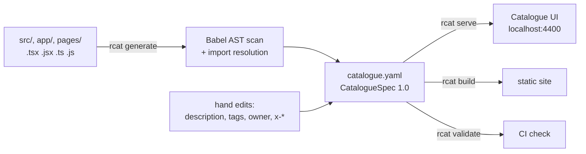

# react-catalogue

Swagger/OpenAPI-style catalogue for React and Next.js frontends. It scans your source, writes a `catalogue.yaml` in the [CatalogueSpec](docs/SPEC.md) format, and serves a browsable UI that shows:

- every component, with props, state, hooks, context, refs and lifecycle
- every page/route and the full component tree it renders
- links in both directions: which components a component renders, which components render it, and which pages it appears on



## Install

```bash
npm install --save-dev react-catalogue
# or straight from GitHub until it is on npm
npm install --save-dev github:Prathmesh2000/frontend-catalog
```

## Commands

| Command | What it does |
|---|---|
| `rcat init` | Writes `catalogue.config.json` with the defaults below. Optional. |
| `rcat generate` | Scans the project and writes `catalogue.yaml`. Hand-written fields are kept. |
| `rcat serve [-p 4400] [-w]` | Generates, then serves the UI. `-w` regenerates and live-reloads on file changes. |
| `rcat build [-o catalogue-site]` | Writes the UI plus data as a static site (host it anywhere). |
| `rcat validate [file]` | Validates a catalogue against the JSON Schema and checks references. Exit code 1 on errors. |

All commands accept `-C <dir>` to run against another project root.

Typical `package.json` scripts:

```json
{
  "scripts": {
    "catalogue": "rcat serve -w",
    "catalogue:check": "rcat generate && rcat validate"
  }
}
```

## Configuration

`catalogue.config.json` in the project root (every key optional):

```json
{
  "title": "shop-web",
  "include": ["."],
  "exclude": ["**/node_modules/**", "**/.next/**", "**/*.test.*", "**/*.stories.*"],
  "output": "catalogue.yaml",
  "port": 4400
}
```

`tsconfig.json` / `jsconfig.json` `baseUrl` and `paths` aliases (`@/components/...`) are resolved automatically.

## What gets detected

| Area | Supported |
|---|---|
| Components | function declarations, arrow functions, `export default function`, anonymous default exports, `memo`, `forwardRef`, class components (`Component`/`PureComponent`) |
| Props | TS param types, `FC<Props>`, `forwardRef<Ref, Props>`, interfaces with `extends`, intersections, `PropsWithChildren`, destructuring defaults, `propTypes`, `defaultProps`, `props.x` / `this.props.x` usage |
| State | `useState`, `useReducer`, class `state = {}` / `this.state = {}` |
| Lifecycle | `useEffect` / `useLayoutEffect` / `useInsertionEffect` (deps → mount/update, cleanup → unmount) and every class lifecycle method, with the functions each one calls |
| Hooks | all hooks, classified as state / effect / context / ref / memo / router / data / custom |
| Routing | Next.js App Router (route groups, parallel slots, dynamic segments, nested layouts), Pages Router (`_app` as layout), React Router `<Route>` trees and `createBrowserRouter` objects |
| Imports | relative paths, tsconfig aliases, barrel files (`export *`, `export { default as X }`), namespace imports (`<UI.Button>`), `lazy()` / `next/dynamic` |

## The spec

`catalogue.yaml` is meant to be committed and reviewed like `openapi.yaml`. The full format, ownership rules and an example are in [docs/SPEC.md](docs/SPEC.md); the JSON Schema is [spec/catalogue.schema.json](spec/catalogue.schema.json). Generated files start with a `yaml-language-server` comment, so VS Code's YAML extension gives completion and validation while you hand-edit.

## Programmatic API

```js
import { loadConfig, generate, scanProject, validateCatalogue } from 'react-catalogue';

const { catalogue, warnings } = scanProject(loadConfig(process.cwd()));
```

## Development

```bash
npm install
npm test
node bin/rcat.js serve -C examples/next-app -w
node bin/rcat.js serve -C examples/react-app -p 4401
```

## Limits

Static analysis only: components created by factories, render props passed through variables, and routes built from runtime data are not followed. Custom hooks are recorded on the components that call them but are not catalogued separately yet.
