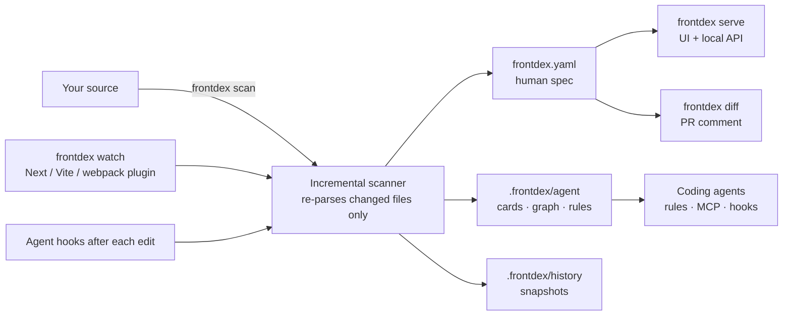

# frontdex

[](https://www.npmjs.com/package/frontdex)
[](https://github.com/Prathmesh2000/frontdex/actions/workflows/ci.yml)
[](LICENSE)

**A living knowledge base of your frontend, for developers and coding agents.** frontdex reads your source code and maps every component, page, route, prop, piece of state, API call, style, test and health issue, then keeps that map current as you code. Think Swagger/OpenAPI, but for your UI.

Works with React, Next.js, Remix, TanStack, Vue, Nuxt, Svelte, SvelteKit, Astro, Angular, Web Components and plain HTML. No runtime code, no model calls, nothing added to your production build.


## Why

| Problem | What frontdex does |
|---|---|
| Nobody knows which page a component ends up on, or what breaks if its props change | Maps component → parents → pages, with impact analysis for any change |
| Coding agents create the fifth `Button`, ignore existing stores and miss callers | Gives agents always-on rules, an MCP server and per-edit feedback so they search, reuse and check impact first |
| PR reviews show file diffs, not what the UI change does | Posts a PR comment with changed components, the pages they reach and new issues |
| Leaks, render loops and dead code are found in production | Flags them statically with `file:line` and a fix |

## What you get

- **For developers:** a UI (`npx frontdex serve`) that starts from URLs: page → layouts → components → props, state, effects, API calls, styles, tests and docs, each linked to `file:line`. Plus `frontdex.yaml`, a reviewable spec of the whole frontend.
- **For coding agents:** `.frontdex/agent/` (Markdown cards and a JSON graph), rules for Claude Code, Cursor, OpenCode, Antigravity, Hermes, Copilot and anything that reads `AGENTS.md`, an MCP server with 23 tools, and hooks that report the impact of every edit.
- **For reviewers and CI:** `frontdex diff` and a GitHub Action that comment on PRs with an impact graph and field-by-field changes, and can fail on new high-severity issues.

## How it works



frontdex parses your code with Babel (and the project's own Vue, Svelte and Astro compilers), links imports, renders and routes into one graph, runs its analyzers, and writes the results. Details: [docs/ARCHITECTURE.md](docs/ARCHITECTURE.md).

## Quick start

From your frontend's root:

```bash
npm install --save-dev frontdex frontdex-mcp   # or pnpm add -D / yarn add -D / bun add -d
npx frontdex init --auto-update                # writes frontdex.config.json
npx frontdex scan                              # builds the knowledge base
npx frontdex agents                            # wires your coding agents (rules, MCP, hooks)
npx frontdex serve                             # UI at http://localhost:4400
```

`frontdex-mcp` is only needed for agents that use MCP. Commit `frontdex.config.json`, `frontdex.yaml` and `.frontdex/` (the cache and history stay git-ignored). `npx frontdex doctor` shows what was detected and what is missing.

Coming from `react-catalogue`? See [docs/MIGRATING.md](docs/MIGRATING.md).

## Coding agents

`npx frontdex agents` sets up every supported agent at once; `--targets` picks some. Prefer to do it by hand? [docs/AGENTS.md](docs/AGENTS.md) has copy-paste rules and MCP config for each one.

| Agent | Rules | MCP | Hooks after edits |
|---|---|---|---|
| Claude Code | `AGENTS.md` / `CLAUDE.md` import | `.mcp.json` | yes |
| Cursor | `.cursor/rules/frontdex.mdc` | `.cursor/mcp.json` | yes |
| OpenCode | `AGENTS.md` | `opencode.json` | – |
| Antigravity | `.agents/rules/frontdex.md` | `.agents/mcp_config.json` | – |
| Hermes | `AGENTS.md` | `~/.hermes/config.yaml` with `--user-config` | – |
| Copilot, Codex, Gemini CLI, others | `AGENTS.md`, `.github/copilot-instructions.md` | their MCP config | – |

The rules tell agents to search before creating a component, read its card before editing, check impact before changing props, reuse existing state, endpoints and styles, run the tests that cover the change, and keep component docs current.

**Let your agent install it.** Paste this into Claude Code, Cursor, Antigravity or any agent:

```text
Set up frontdex in this project: install frontdex and frontdex-mcp as dev dependencies, run
`npx frontdex init --auto-update`, `npx frontdex scan`, then `npx frontdex agents --targets <your agent>`.
Then read .frontdex/agent/INDEX.md and follow its rules from now on.
```

Agents can also read [llms.txt](llms.txt).

## Features

| Feature | In short | Reference |
|---|---|---|
| Page-first UI | Site map, component pages, graph, state, health, design tokens, history, tests and docs views; `Ctrl K` search with a query language (`uses:Button is:shared`) | [The UI](docs/USAGE.md#the-ui) |
| Rendering and navigation | The condition each child renders under, screens switched by state, links between pages, routes from constants, params and static data | [What gets detected](docs/USAGE.md#what-gets-detected) |
| PR impact | `frontdex diff origin/main` and a GitHub Action comment: impact graph, before/after per field, new issues | [Pull requests and CI](docs/USAGE.md#pull-requests-and-ci) |
| Tests | Unit and E2E tests mapped to components and pages, runnable from the UI | [Tests](docs/USAGE.md#tests) |
| Component docs | Your coding agent writes Storybook-style docs through MCP; stored in the repo, flagged when stale | [Component docs](docs/USAGE.md#component-docs-from-your-coding-agent) |
| Health | Memory leaks, render loops, unsafe async updates, stale deps, dead code, accessibility, heavy imports | [What gets detected](docs/USAGE.md#what-gets-detected) |
| Design system | Duplicate components, design tokens, hard-coded values that should use them | [Commands](docs/USAGE.md#commands) |
| Live updates | `frontdex watch` or the Next/Vite/webpack plugin: a save shows up in about 130 ms on a 20k-component repo | [Auto-update](docs/USAGE.md#auto-update) |
| History | Git-like snapshots of the catalogue with field-level changes | [History](docs/USAGE.md#history) |

To try it without your own project, clone this repo, run `npm ci`, then `node bin/frontdex.js serve -C examples/next-app`.

## Documentation

| Doc | For |
|---|---|
| [docs/USAGE.md](docs/USAGE.md) | Every command, plugin, CI setup, configuration option, and what gets detected |
| [docs/AGENTS.md](docs/AGENTS.md) | Setting up each coding agent, automatically or by hand |
| [docs/SPEC.md](docs/SPEC.md) | The `frontdex.yaml` format (CatalogueSpec) |
| [docs/ARCHITECTURE.md](docs/ARCHITECTURE.md) | How frontdex works inside |
| [docs/MIGRATING.md](docs/MIGRATING.md) | Moving from react-catalogue |
| [frontdex-mcp](https://github.com/Prathmesh2000/frontdex-mcp) | The MCP server and its tools |
| [CHANGELOG.md](CHANGELOG.md) | Release notes |

## Contributing

Issues and pull requests are welcome, especially detection gaps: a router, pattern or framework frontdex misses. Start with [CONTRIBUTING.md](CONTRIBUTING.md) and [docs/ARCHITECTURE.md](docs/ARCHITECTURE.md). Coding agents working on this repo should read [AGENTS.md](AGENTS.md). Everyone follows the [Code of Conduct](CODE_OF_CONDUCT.md); report security issues as described in [SECURITY.md](SECURITY.md).

## License and credit

frontdex is open source under the [Apache License 2.0](LICENSE), created by [Prathmesh Agrawal](https://github.com/Prathmesh2000). You can use it, change it and ship it, commercially or not. If you redistribute frontdex or a modified version, keep the [LICENSE](LICENSE) and [NOTICE](NOTICE) files with it and mark the files you changed.

If frontdex helps your project, a mention is appreciated:

```markdown
Frontend knowledge base by [frontdex](https://github.com/Prathmesh2000/frontdex).
```

Versions up to 0.3.x were published under the MIT license and remain available under it.
