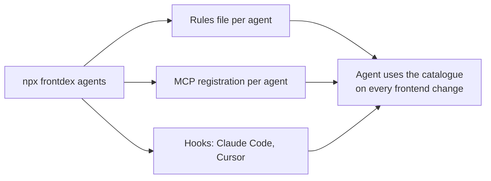

# Coding agents

frontdex gives a coding agent three things: **rules** it always loads (search before creating a component, check impact before changing props, run the covering tests, …), an **MCP server** with the catalogue tools, and, for Claude Code and Cursor, **hooks** that tell the agent what its edit affected right after each edit.

Two ways to set an agent up:

- **Automatic**: `npx frontdex agents` writes everything below for every supported agent, between `<!-- frontdex -->` markers so your own content is kept. Rerun it any time; it is idempotent. `--targets cursor,antigravity` limits it to some agents, `--remove` takes it all out again.
- **By hand**: copy the snippets from the section for your agent.



Prerequisites, once per project:

```bash
npm install --save-dev frontdex frontdex-mcp
npx frontdex init --auto-update
npx frontdex scan
```

## What gets written

| Agent | `--targets` name | Rules | MCP server | Hooks |
|---|---|---|---|---|
| Claude Code | `claude` | `@.frontdex/agent/RULES.md` import in an existing `CLAUDE.md` (otherwise it reads `AGENTS.md`) | `.mcp.json` | `.claude/settings.json` |
| Cursor | `cursor` | `.cursor/rules/frontdex.mdc` | `.cursor/mcp.json` | `.cursor/hooks.json` |
| OpenCode | `opencode` | `AGENTS.md` | `opencode.json` (or `opencode.jsonc`) | – |
| Antigravity | `antigravity` | `.agents/rules/frontdex.md` (`.agent/rules/` in projects that already use it) | `.agents/mcp_config.json` | – |
| Hermes | `hermes` | `AGENTS.md`, or an existing `.hermes.md` / `HERMES.md` | `~/.hermes/config.yaml`, only with `--user-config` | – |
| GitHub Copilot | `copilot` | `.github/copilot-instructions.md` | – | – |
| Codex, Gemini CLI, Zed, others | `agents-md` | `AGENTS.md` | their own MCP config, see [Any other agent](#any-other-agent) | – |

The MCP command is always `npx frontdex mcp`, which starts frontdex-mcp from your project. Add `-C <path>` if an agent launches it from another directory.

## The rules

Every agent gets the same rules, so they never disagree. `frontdex agents` also writes them to `.frontdex/agent/RULES.md`. To copy them by hand, use this text (it assumes the default `.frontdex` knowledge folder and `frontdex.yaml` output):

````markdown
## Frontend knowledge base (frontdex)

This project keeps a generated map of every React component and page in `.frontdex/agent/` (start at `.frontdex/agent/INDEX.md`). Follow these rules for every frontend change:

1. **Before creating a component**, check for an existing one: MCP tool `catalogue_find_existing` with the name and props you plan (or `npx frontdex find <Name> --props a,b`), and `catalogue_search` / `npx frontdex query "<terms or filters>"` (filters: `uses:Button`, `hook:useQuery`, `prop:onClose`, `is:shared`). Reuse or extend instead of duplicating. Use design tokens (`catalogue_tokens`) instead of hard-coded colors and sizes.
2. **Before editing a component**, read its card: `catalogue_component`, `npx frontdex show <Name>`, or `.frontdex/agent/components/<source folder>.md`.
3. **Before changing props, exports or behaviour**, check the blast radius with `catalogue_impact` or `npx frontdex impact <Name>`, and update every caller in the same change.
4. **Reuse what exists**: check `catalogue_state` (Redux/context/zustand), `catalogue_api` (endpoints) and `catalogue_styles` (CSS classes) before adding new state, API calls or styles.
5. **Do not ship regressions**: every effect that starts an interval, listener, subscription or observer must release it in its cleanup; avoid unused variables/props/imports. Check `catalogue_health` (or `npx frontdex health`) for the components you touched.
6. **After editing components or routes**, run `catalogue_rescan` or `npx frontdex scan`, and mention notable catalogue changes in your summary.
7. **Run the tests that cover what you changed**: `catalogue_tests` (or `npx frontdex tests <Name>`) lists the unit and E2E tests mapped to a component or page, with the command to run them.
8. **Keep component docs current**: when you have read a component closely or changed it, save what it is for and how to use it with `catalogue_enrich_write` (`catalogue_enrich_next` lists components whose docs are missing or stale). Developers see these docs in the frontdex UI, and the next agent reads them.
9. Do not hand-edit `.frontdex/` or `frontdex.yaml`, except the human-owned fields (description, tags, owner, x-*).
````

Below, "the rules" means this block.

## Claude Code

Automatic: `npx frontdex agents --targets claude,agents-md`. Claude Code asks once to approve the project MCP server.

By hand:

1. Rules: paste the rules into `AGENTS.md`. If the project has a `CLAUDE.md`, Claude Code reads that instead, so add a line `@AGENTS.md` (or paste the rules into `CLAUDE.md`).
2. MCP, `.mcp.json`:

   ```json
   { "mcpServers": { "frontdex": { "type": "stdio", "command": "npx", "args": ["frontdex", "mcp"] } } }
   ```

   Or: `claude mcp add --scope project frontdex -- npx frontdex mcp`.
3. Hooks (optional), `.claude/settings.json`:

   ```json
   {
     "hooks": {
       "PostToolUse": [{ "matcher": "Edit|Write|MultiEdit", "hooks": [{ "type": "command", "command": "npx frontdex hook post-edit --format claude", "timeout": 60 }] }],
       "SessionStart": [{ "matcher": "startup|resume|clear|compact", "hooks": [{ "type": "command", "command": "npx frontdex hook session-start --format claude", "timeout": 60 }] }]
     }
   }
   ```

## Cursor

Automatic: `npx frontdex agents --targets cursor`.

By hand:

1. Rules, `.cursor/rules/frontdex.mdc`:

   ```markdown
   ---
   description: Frontend component knowledge base (frontdex)
   alwaysApply: true
   ---

   <the rules>
   ```

2. MCP, `.cursor/mcp.json`:

   ```json
   { "mcpServers": { "frontdex": { "type": "stdio", "command": "npx", "args": ["frontdex", "mcp"] } } }
   ```

3. Hooks (optional), `.cursor/hooks.json`:

   ```json
   {
     "version": 1,
     "hooks": {
       "postToolUse": [{ "command": "npx frontdex hook post-edit --format cursor", "matcher": "Write|Edit" }],
       "sessionStart": [{ "command": "npx frontdex hook session-start --format cursor" }]
     }
   }
   ```

## OpenCode

Automatic: `npx frontdex agents --targets opencode,agents-md`.

By hand:

1. Rules: paste them into `AGENTS.md`.
2. MCP, `opencode.json`:

   ```json
   {
     "$schema": "https://opencode.ai/config.json",
     "mcp": { "frontdex": { "type": "local", "command": ["npx", "frontdex", "mcp"], "enabled": true } }
   }
   ```

## Antigravity

Automatic: `npx frontdex agents --targets antigravity`.

By hand:

1. Rules, `.agents/rules/frontdex.md` (Antigravity requires the `trigger` front matter; always-on rules are limited to 12,000 characters, the frontdex rules use about 3,500):

   ```markdown
   ---
   trigger: always_on
   description: Frontend component knowledge base (frontdex)
   ---

   <the rules>
   ```

2. MCP, `.agents/mcp_config.json` in the project:

   ```json
   { "mcpServers": { "frontdex": { "command": "npx", "args": ["frontdex", "mcp"] } } }
   ```

   To register it for yourself instead of for the project, put the same entry in `~/.gemini/config/mcp_config.json` with `"args": ["frontdex", "mcp", "-C", "/absolute/path/to/project"]`.

## Hermes

Automatic: `npx frontdex agents --targets hermes,agents-md --user-config`. Without `--user-config` the MCP snippet is only printed, because Hermes keeps MCP servers in your home directory. With it, frontdex edits `~/.hermes/config.yaml` in place (comments and other servers are kept, the previous file is saved as `config.yaml.bak`).

By hand:

1. Rules: paste them into `AGENTS.md`. Hermes reads only the first context file it finds, so if the project has `.hermes.md` or `HERMES.md`, paste them there instead.
2. MCP, `~/.hermes/config.yaml`:

   ```yaml
   mcp_servers:
     frontdex:
       command: "npx"
       args: ["frontdex", "mcp"]
   ```

## GitHub Copilot

Automatic: `npx frontdex agents --targets copilot`. By hand: paste the rules into `.github/copilot-instructions.md`. Register the MCP server in your editor's Copilot MCP settings with `npx frontdex mcp` as the command.

## Any other agent

Codex, Gemini CLI, Zed, Windsurf, Aider and most other agents read `AGENTS.md`: run `npx frontdex agents --targets agents-md` or paste the rules there. For MCP, register a stdio server named `frontdex` with command `npx` and args `["frontdex", "mcp"]` in that agent's MCP config.

## Let your agent do the setup

Paste this into your coding agent from the project root:

```text
Set up frontdex in this project: install frontdex and frontdex-mcp as dev dependencies with the
project's package manager, run `npx frontdex init --auto-update`, `npx frontdex scan`, then
`npx frontdex agents --targets <your agent>`. Show me the files it created, then read
.frontdex/agent/INDEX.md and follow the rules in it from now on.
```

Agents that read [llms.txt](../llms.txt) can find the same instructions there.
