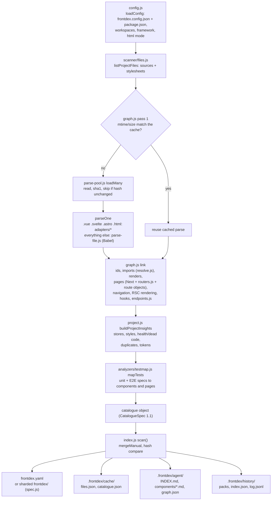
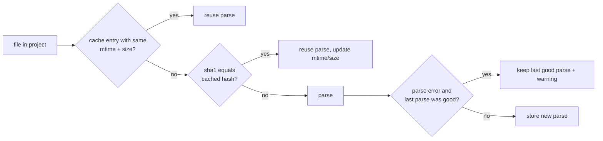
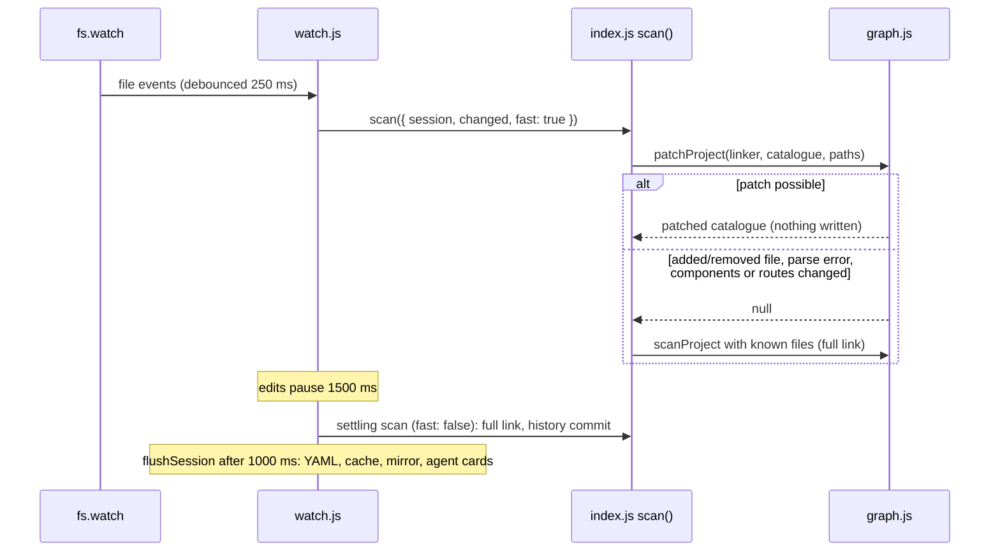
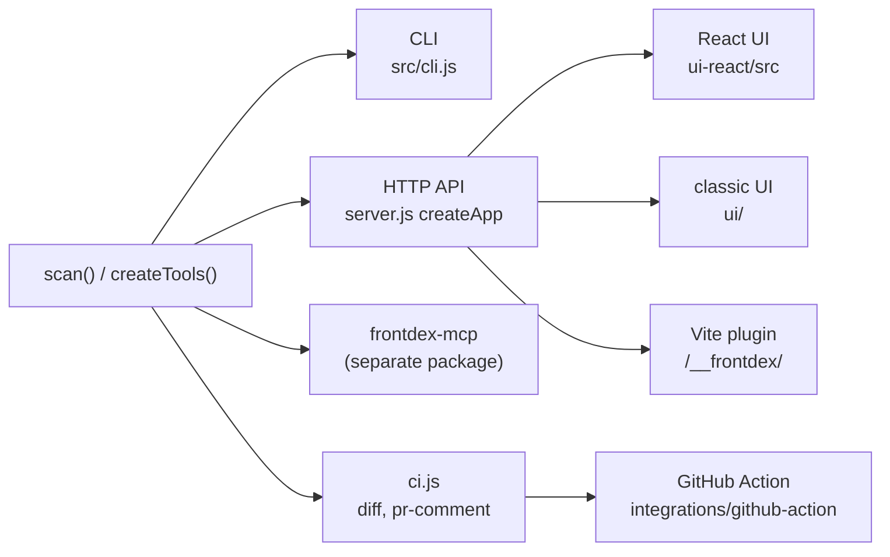

# frontdex architecture

How a source tree becomes `frontdex.yaml`, the agent knowledge base and the data behind the CLI, HTTP API, UI and MCP server. Read this before changing anything under `src/`.

## Pipeline



`scanProject()` in `src/scanner/graph.js` produces the catalogue and touches nothing on disk. `scan()` in `src/index.js` is the only function that writes outputs. Everything else (CLI, server, watcher, tools, CI) goes through `scan()` or reads its result.

### What happens at parse time vs link time

| Stage | Runs | Sees | Produces |
|---|---|---|---|
| Parse (`parseOne`) | per file, cacheable, can run in a worker | one file's source | a module: `imports`, `exports`, `reexports`, `exportAll`, `aliases`, `components`, `routes`, `customHooks`, `schemas`, `consts`, per-component diagnostics |
| Link (`scanProject`) | every scan, main thread | all modules | ids, `renders`/`usedBy`, pages, `navigatesTo`, `rendering`, hooks, endpoints |
| Project insights (`project.js`, `testmap.js`) | every scan | linked components, pages, stylesheets | stores, styles, health totals, dead code, duplicates, tokens, tests |

A parse result must depend only on the file's own contents. Anything that needs another file belongs in linking.

## Module map

| File | Responsibility |
|---|---|
| `bin/frontdex.js` | Entry point; calls `main()` in `src/cli.js`. Published as `frontdex`, `fdx`, `rcat`, `react-catalogue`. |
| `src/cli.js` | Argument parsing (`node:util` `parseArgs`), the `HELP` text and one `case` per command. `--json` routes query commands to `createTools(config).data`. |
| `src/config.js` | `loadConfig`, `initConfig`, defaults (include/exclude, `output`, `shard`, `port`, `knowledgeDir`, history, agents), react-catalogue legacy names and `upgradeProject`. |
| `src/index.js` | Public API. `scan()` (incremental scan, writes, history), `flushSession()`, `upgradeCatalogue()`, re-exports. Types in `src/index.d.ts`. |
| `src/spec.js` | Read/write the YAML (single file or sharded above 500 components with `shard: "auto"`), `validateCatalogue` (Ajv against the schema), `mergeManual` (human-owned fields). |
| `src/scanner/files.js` | Directory walk, include/exclude globs, `SOURCE_EXT`, `STYLE_EXT`, watcher-path updates. |
| `src/scanner/parse-pool.js` | `parseOne` (picks adapter or Babel), `loadOne` (hash check), `loadMany` (worker threads). |
| `src/scanner/parse-worker.js` | Worker side of `loadMany`; posts results in chunks of 25. |
| `src/scanner/parse-file.js` | Babel parse of JS/TS/JSX: components, exports, route declarations (React Router, Vue Router, TanStack `createFileRoute`, React Router v7 `app/routes.ts`), JSX a11y, CSS-in-JS, i18n text. |
| `src/scanner/component.js` | Per-component extraction for function and class components: props, state, hooks, lifecycle, JSX children, navigation targets. |
| `src/scanner/insights.js` | Deeper per-component analysis and most diagnostics (`memory-leak`, `render-loop`, `unsafe-async-update`, `missing-dependency`, `unused-*`, …). |
| `src/scanner/angular.js`, `webcomponents.js` | `@Component` classes and custom elements, recorded with a `tag` so markup links to them. |
| `src/scanner/adapters/` | `vue.js`, `svelte.js`, `astro.js`, `html.js`. Same module shape as `parseFile()`. Compilers load from the scanned project first (`common.js` `loadFromProject`). |
| `src/scanner/graph.js` | `scanProject` (cache, link, assemble), `patchProject` (watch fast path), `assignIds` (stable ids and aliases). |
| `src/scanner/resolve.js` | Import resolution: relative paths, tsconfig/jsconfig `paths`/`baseUrl` with `extends`, workspace packages and their `exports` maps. |
| `src/scanner/paths.js` | Route and link path expressions: parsed into parts at parse time, evaluated in `graph.js` once constants are known. |
| `src/scanner/routers.js` | File-system routers other than Next.js: Remix, React Router v7, TanStack, Gatsby, SolidStart, Qwik City, Nuxt, SvelteKit, Astro, plain HTML. |
| `src/scanner/endpoints.js` | Next.js route handlers, Pages Router API routes, middleware, server actions; SvelteKit and Astro roots. |
| `src/scanner/workspace.js` | Package manager and monorepo workspace detection. |
| `src/scanner/project.js` | Cross-file insights: stores, styles, health and dead code; calls `duplicates.js` and `tokens.js`. |
| `src/scanner/analyzers/` | `a11y`, `cssinjs`, `duplicates`, `i18n`, `ownership` (CODEOWNERS, tests/stories beside a file), `perf` (heavy imports), `stories`, `testmap`, `tokens`. |
| `src/query.cjs` | Search index and filter language (`uses:`, `hook:`, `is:shared`, …). UMD, dependency-free ES2020: loaded by Node and by the browser UI. |
| `src/tools.js` | `createTools(config)`: `tools` (Markdown answers, MCP-shaped), `data` (same queries as plain objects), `refresh`. Rescans at most every 2 s. |
| `src/agent-kb.js` | Writes `.frontdex/agent/`: `INDEX.md`, one card file per source folder, `graph.json`. |
| `src/agents.js` | `frontdex agents`: rules, MCP registration and hooks per agent target; `runHook` for `post-edit` / `session-start`. |
| `src/enrichment.js` | Agent-written component docs in `.frontdex/enrichment/`, validated against `spec/enrichment.schema.json`, marked stale by a component signature. |
| `src/history.js` | Content-addressed snapshot store and diff formatting. |
| `src/ci.js` | `catalogueAtRef`, `buildReport`, text/Markdown formatting for `diff` and `pr-comment`. |
| `src/server.js` | `createApp` (UI + HTTP API as a plain handler), `startServer`, `buildSite`, `subgraph`. |
| `src/watch.js` | `startWatcher`: `fs.watch`, debounce, fast patch, settling scan, deferred flush. |
| `src/test-runner.js` | Builds and runs the project's test command for one catalogued test file (used by the server's tests API). |
| `src/doctor.js`, `src/fix.js` | `frontdex doctor` (what was detected) and `frontdex fix` (remove unused imports, exact token replacements). |
| `src/plugins/` | Vite plugin (mounts the app at `/__frontdex/`, live preview, overlay), Next.js wrapper and webpack/Rspack plugin (both spawn `frontdex watch` via `watcher.cjs`). |
| `src/overlay/overlay.js` | Dev overlay: Alt+hover in the running app shows the component; no imports. |
| `ui/` | Classic UI (plain JS). Served when `ui-react/dist` is missing, and always at `/classic/`. Used by `frontdex build`. |
| `ui-react/src/` | React UI (TanStack Router, Vite). Talks to the HTTP API through `api.ts`; built into `ui-react/dist`. |
| `spec/` | `catalogue.schema.json` (source of truth), generated `catalogue.d.ts`, `enrichment.schema.json`. |
| `scripts/schema-types.js` | `npm run gen:types`: schema to `spec/catalogue.d.ts`. |
| `integrations/github-action/action.yml` | Composite action: `frontdex check`, `frontdex pr-comment`, sticky PR comment, optional `--fail-on` gate. |
| `bench/scan.js` | Scan benchmark on a synthetic project made of copies of `examples/next-app`. |
| `compat/react-catalogue/` | Shim package for the old name. |

## Data model

The catalogue's shape is defined once, in [`spec/catalogue.schema.json`](../spec/catalogue.schema.json). [`docs/SPEC.md`](SPEC.md) explains every field, the id rules, the issue types and the versioning policy. `spec/catalogue.d.ts` is generated from the schema; `test/types.test.js` fails when it is stale.

Two rules from the code that matter when you change the model:

- **Ids are stable.** `assignIds()` keeps an id a component had in the previous catalogue, treats a single vanished + single new holder of a name as a move (old id recorded in `aliases`), and qualifies a name as `Name@file` only when it collides.
- **Human-owned fields survive rescans.** `mergeManual()` in `spec.js` copies `description`, `status`, `tags`, `owner`, prop descriptions and any `x-*` key from the previous document, following aliases for moved components.

## Incremental scan



- **Cache file**: `.frontdex/cache/files.json`, keyed by path relative to the root. Its `version` is `CACHE_VERSION = <package version>/<sha1 of every .js file under src/scanner/>`. Any edit to scanner code invalidates every cached parse, so you never need to clear the cache by hand after changing the scanner.
- **Catalogue mirror**: `.frontdex/cache/catalogue.json` holds the last catalogue plus the YAML's mtime and size. `readPrevious()` uses it instead of parsing a large YAML while the YAML is untouched.
- **Cached records are never mutated.** Linking mutates components (ids, validation, store reads/writes, issues), so `deserialize()` copies exactly those parts (`cloneMutable`). If linking starts mutating another field, add it there. The test "watch-session rescans reproduce the cold scan exactly" in `test/knowledge.test.js` guards this.
- **Change detection**: `scan()` hashes the catalogue without `info.generatedAt`. Unchanged hash means no YAML write, no agent card rewrite and no history commit.

### Worker threads

`loadMany()` in `parse-pool.js` decides:

| Condition | Behaviour |
|---|---|
| fewer than 400 files to parse, or fewer than 2 threads | parse on the main thread |
| otherwise | `min(MAX_THREADS, floor(files / 200))` workers, `MAX_THREADS = max(2, floor(availableParallelism / 2) - 1)` |

Workers run with `maxOldGenerationSizeMb: 256`. `loadMany` stays synchronous: the main thread blocks on a shared `Int32Array` counter (`Atomics.wait`) and drains each port with `receiveMessageOnPort`. A worker silent for 20 s is treated as dead and its remaining files are parsed on the main thread. Modules cross the thread boundary with their `Map` fields (`imports`, `exports`, `aliases`) as entry arrays (`MAP_FIELDS`); the cache stores them the same way.

### Watch mode and the fast patch



`patchProject()` re-parses only the changed files and re-links only their components. Two fingerprints in `graph.js` decide how far it goes:

- `shapeOf(mod)`: component names and tags, routes, `fileRoute`, `routeConfig`. A change here returns `null` (ids or pages may move), so a full scan runs.
- `interfaceOf(mod)`: exports, re-exports, `export *`, aliases, custom hooks, schemas, constants, module-level renders. A change here also re-links every importer, following barrels through `importersOf()`.

Fields filled by project-wide passes are listed in `CARRIED` (`styles`, `usedBy`, `pages`, `rendering`, `codeowners`, `tests`, `testedBy`, `stories`, `examples`, `navigatesTo`). A patched record keeps the previous values for those, and keeps issues that did not come from parsing. `usedBy` of children is adjusted for added and removed renders. The settling full scan recomputes everything. If you add a field computed after linking, add it to `CARRIED` or the fast patch drops it.

The session object (passed by watch, serve and long-lived callers) keeps the cache, file list, resolver and catalogue in memory. With a session, YAML, cache and agent cards are written by `flushSession()` instead of on every scan. The reused resolver does not see tsconfig edits; the watcher ignores `.json` files, so restart it after changing `paths`.

## History

`src/history.js`, under `.frontdex/history/` (git-ignored by default through `.frontdex/.gitignore`):

```
history/packs/<commit>.json.gz   objects first seen in that commit (components, pages, manifest)
history/index.json               object hash -> pack
history/log.jsonl                one commit per line: parent, time, manifest hash, git HEAD, change list
```

Objects are content-addressed by sha1 of a key-sorted JSON form, so an unchanged component costs nothing in a new commit. `scan()` commits when the catalogue changed or the log is empty. The log keeps the last `history.limit` commits (default 500). `usedBy`, `pages` and `line` on components and `components` on pages are ignored when deciding what changed, because they move when other code changes. Consumers: `frontdex history`, `frontdex adoption`, `/api/history`, `catalogue_history`, `catalogue_adoption`.

## Outputs

| Output | Writer | Notes |
|---|---|---|
| `frontdex.yaml` or `frontdex/index.yaml` + `frontdex/components/*.yaml` | `spec.js` `writeCatalogue` | Human spec, committed. Sharded when `shard` is `true`, or `"auto"` and more than 500 components. |
| `.frontdex/agent/INDEX.md`, `components/<folder>.md`, `graph.json` | `agent-kb.js` | Regenerated when the catalogue changes, when `agent-kb.js` itself changes (`AGENT_FORMAT` hash in `index.js`), or when enrichment docs change. |
| `.frontdex/agent/RULES.md` and agent config files | `agents.js` | Only on `frontdex agents`. |
| `.frontdex/enrichment/*.json` | `enrichment.js` | One file per component, written only by an agent through `catalogue_enrich_write`. frontdex makes no model calls. |
| `.frontdex/cache/` | `index.js` | Machine-local, git-ignored. |
| `.frontdex/history/` | `history.js` | Local by default. |

## Consumers



**CLI.** Query commands (`show`, `impact`, `query`, `health`, …) call the same `createTools(config)` the MCP server uses: `tools.*` for text, `data.*` for `--json`.

**HTTP API.** `createApp()` returns a plain `(req, res)` handler. `frontdex serve` mounts it at the root; the Vite plugin mounts it at `/__frontdex/`. Routes include `/api/catalogue`, `/api/components` (paged), `/api/component`, `/api/folders`, `/api/pages`, `/api/section`, `/api/issues`, `/api/graph`, `/api/info`, `/api/history`, `/api/diff`, `/api/source`, `/api/enrichment`, `/api/tests*`, `/api/events` (Server-Sent Events) and `POST /api/rescan`. Security rules in the code:

- `startServer` listens on `127.0.0.1` unless `FRONTDEX_HOST` is set.
- `/api/*` and `/data.js` return 403 unless the `Host` header is `localhost`, `127.0.0.1` or `[::1]` (blocks DNS rebinding) and, unless `allowLan` (set by `FRONTDEX_HOST`), the socket peer is loopback (blocks LAN clients when mounted on a dev server started with `vite --host`).
- CORS is granted only to `http(s)://localhost|127.0.0.1|[::1]` origins, for the dev overlay.
- `/api/source` serves only files inside the root with an extension in `SOURCE_EXT`.
- `POST /api/tests/run` (the one call that executes code) requires a loopback peer even with `allowLan`, `Content-Type: application/json`, and a local `Origin` when one is sent. `test-runner.js` validates the request against `catalogue.tests` before building the command.

**React UI.** `ui-react/src` is a Vite + React 19 + TanStack Router app. It never loads the whole catalogue: lists are paged through the API (`api.ts`). In development, `npm run dev:ui` proxies `/api` to `http://127.0.0.1:4400`, so run `frontdex serve` alongside it. `npm run build:ui` writes `ui-react/dist`, which `prepack` builds and the npm package ships.

**MCP.** The server is the separate package [frontdex-mcp](https://github.com/Prathmesh2000/frontdex-mcp). `frontdex mcp` resolves `frontdex-mcp` from the project (then from frontdex itself) and calls its `startMcpServer(config)`. That server calls `createTools(config)` from `frontdex` and dispatches `tools/call` to `tools[name]`. The tool names, descriptions and `inputSchema`s live in the `TOOLS` array in frontdex-mcp's `src/server.js`, not in this repo.

**GitHub Action.** `integrations/github-action/action.yml` runs `npx --no-install frontdex check`, `frontdex pr-comment origin/<base>`, updates one sticky comment found by the `<!-- frontdex-pr-report -->` marker (`COMMENT_MARKER` in `ci.js`), and optionally gates with `frontdex diff --fail-on`. `catalogueAtRef()` reads the YAML committed at the base ref, or scans a temporary worktree when there is none or `--scan` is passed.

**Bundler plugins.** `next.cjs` and `webpack.cjs` spawn `frontdex watch --parent-pid` during dev only. `vite.js` also serves the UI, a per-component live preview and the overlay.

## Where to add X

### A router or framework

| What | Where |
|---|---|
| File-system router | A function in `src/scanner/routers.js` returning `{ route, router, file, params, page, layouts }` descriptors, plus one line in `fileSystemRoutes()` keyed on the app's dependencies. `graph.js` turns descriptors into pages. |
| Routes declared in code | `src/scanner/parse-file.js` (fills `mod.routes`, `mod.fileRoute` or `mod.routeConfig`), evaluated and linked in `graph.js`. Path expressions go through `paths.js`. |
| Next.js | Handled inside `graph.js` (`nextRoots`) and `endpoints.js`. |
| New file type | An adapter in `src/scanner/adapters/` returning the same module shape as `parseFile()`, registered in `ADAPTERS` in `parse-pool.js`, and the extension added to `SOURCE_EXT` in `files.js`. Load the compiler with `loadFromProject()` so frontdex gains no runtime dependency. |
| Framework detection | `FRAMEWORK_DEPS` in `config.js` (decides whether `.html` files are pages). |

Add a test in `test/routers.test.js` or `test/adapters.test.js` (both write a throwaway project to a temp dir and scan it).

### An analyzer or diagnostic

- Per-component, from one file: push `issue(type, severity, message, line, fix)` in `analyzeComponent()` in `src/scanner/insights.js`, or add a module under `src/scanner/analyzers/` and call it from `parse-file.js` (as `a11y.js` and `i18n.js` are).
- Cross-file (dead code, duplicates, tokens): `src/scanner/project.js` or a new analyzer it calls.
- `Issue.type` is a free string in the schema, so no schema change is needed. Document the type in the Issue table in `docs/SPEC.md`. `severity` must be `high`, `medium`, `low` or `info`.
- If the issue is computed after linking, it is carried by the fast patch automatically (only parse-time issues are recomputed there).
- If the examples trigger it, the golden test fails; regenerate the example outputs (see CONTRIBUTING.md).

### An MCP tool

1. Add `catalogue_<name>` to the `tools` object in `src/tools.js`. It takes one plain-object argument and returns Markdown text.
2. If it has a structured form, add it to `data` too and wire a CLI command in `src/cli.js` (`HELP`, a `case`, and `DATA_ARGS` for `--json`).
3. In the frontdex-mcp repo, add an entry to `TOOLS` in `src/server.js` with `name`, `description` and `inputSchema`. Without it the tool exists but agents never see it in `tools/list`. Its `test/server.test.js` asserts the tool count (currently 23), so update that too.
4. If agents should use it by default, mention it in `rulesFor()` in `src/agents.js` and in `INSTRUCTIONS` in frontdex-mcp.

### An agent target

1. Add the name to `TARGETS` in `src/agents.js`. The CLI help and `--targets` validation read that array.
2. Add an `if (want('<name>'))` block in `installAgents()`. Use the existing helpers: `upsertBlock` (a marked block inside a shared file), `writeOwnFile` (a file frontdex owns), `updateJson` + `setServer` (MCP registration). Each must handle `remove`, `mcp` and `hooks`.
3. Add a test in `test/knowledge.test.js` that installs and removes the target in a temp project.
