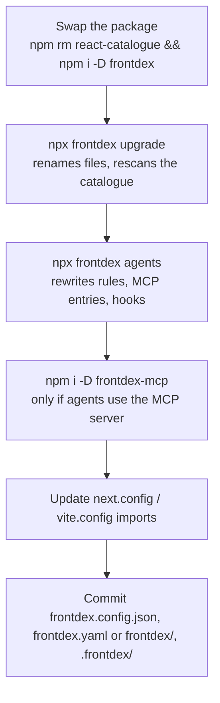

# Migrating from react-catalogue 0.2 to frontdex 0.3

react-catalogue is now frontdex. Nothing breaks on the day you install it: frontdex reads the old file names, answers to the old command names and still exports `withCatalogue`. The steps below move you to the new names so the compatibility paths can go later.



## 1. Swap the package

```bash
npm rm react-catalogue && npm i -D frontdex
```

If you can't change every config and script at once, there is a `react-catalogue` 0.3.0 compatibility package (source in [compat/react-catalogue](../compat/react-catalogue), prepared but not yet published). It depends on frontdex and re-exports it:

| Old entry point | Maps to |
|---|---|
| `react-catalogue` | `frontdex` (emits a `DeprecationWarning` on import) |
| `react-catalogue/next` | `frontdex/next` |
| `react-catalogue/vite` | `frontdex/vite` |
| `react-catalogue/query` | `frontdex/query` |
| `react-catalogue/schema.json` | `frontdex/schema.json` |
| `rcat`, `react-catalogue` commands | the frontdex CLI, after a one-line notice on stderr (so `--json` output stays clean) |

Treat it as a bridge, not a destination.

## 2. Run `frontdex upgrade`

```bash
npx frontdex upgrade
```

Until you run it, `init`, `scan`, `watch`, `serve` and `check` print this notice on stderr (`--quiet` hides it):

```
• This project uses react-catalogue file names. Run "frontdex upgrade" to move to frontdex.config.json, frontdex.yaml and .frontdex/.
```

### What it moves

| Before | After |
|---|---|
| `catalogue.config.json` | `frontdex.config.json` |
| `catalogue.yaml` | `frontdex.yaml` |
| `.catalogue/` (agent cards, history, cache) | `.frontdex/` |

Details that matter:

- It only acts on a project that has at least one of the old names and no `frontdex.config.json` yet. Running it again is safe: the file moves are skipped, and the catalogue rescan below runs again without changing IDs.
- If your old config set `output` or `knowledgeDir` to a custom path, that path is left where it is and kept in the new config. Only the default names move.
- A move is skipped if the destination already exists. It never overwrites.
- The schema hint on the first line of the YAML is rewritten from `node_modules/react-catalogue/` to `node_modules/frontdex/`.
- `frontdex.config.json` is written only if you had a `catalogue.config.json`. Projects that ran on defaults get the moved files and no config.

### What it does to the catalogue

After the moves, `upgrade` runs a full rescan against your existing catalogue:

- **Stable IDs.** Every ID already in the catalogue is kept as the baseline. From now on, IDs survive rescans: a new component that reuses an existing name in another file gets `Name@path/to/file` instead of renaming the existing one.
- **Aliases.** If a component's ID changed because its file moved since your last scan, the old ID goes into a new top-level `aliases` map pointing at the new one. Manual fields, history and `frontdex diff` follow aliases, and lookups by the old ID still resolve. `upgrade` prints each alias it adds.
- **Sharding.** The `shard` option defaults to `auto`: above 500 components, the catalogue is written as `frontdex/index.yaml` plus files under `frontdex/components/`, and the single `frontdex.yaml` is removed. Set `"shard": false` in the config before running `upgrade` if you want to keep one file, for example because a script reads `frontdex.yaml` directly. Once a project is sharded it stays sharded under `auto`.
- History is keyed by the same IDs, so existing snapshots stay readable. The rescan records one snapshot with the message `frontdex upgrade`.

## 3. Rewire coding agents

```bash
npx frontdex agents
```

It replaces what react-catalogue wrote instead of adding a second copy:

| File | Old | After `frontdex agents` |
|---|---|---|
| `AGENTS.md`, `CLAUDE.md`, `.hermes.md`, `HERMES.md`, `.github/copilot-instructions.md` | `<!-- react-catalogue:start -->` … `<!-- react-catalogue:end -->` block | the block is replaced by a `<!-- frontdex:start -->` block |
| `.mcp.json`, `.cursor/mcp.json` | server `react-catalogue`, `npx react-catalogue mcp` | server `frontdex`, `npx frontdex mcp` |
| `opencode.json` / `opencode.jsonc` | `mcp.react-catalogue` | `mcp.frontdex` |
| `.claude/settings.json` | `PostToolUse` / `SessionStart` hooks running `npx react-catalogue hook …` | the same hooks running `npx frontdex hook …` |
| `.cursor/hooks.json` | `postToolUse` / `sessionStart` hooks running `npx react-catalogue hook …` | the same hooks running `npx frontdex hook …` |
| `.cursor/rules/react-catalogue.mdc` | rule file | deleted, replaced by `.cursor/rules/frontdex.mdc` |

The new rules name your project's actual knowledge folder and YAML file, so run this after `upgrade`, not before.

Hermes MCP servers live in your user-level `~/.hermes/config.yaml`, which `frontdex agents` does not touch. Change `react-catalogue` to `frontdex` in its `args` by hand.

## 4. Install the MCP server separately

In 0.2 the MCP server was part of the package. In 0.3 it is its own package, [frontdex-mcp](https://github.com/Prathmesh2000/frontdex-mcp):

```bash
npm i -D frontdex-mcp
```

`frontdex mcp` (which is what the registered entries run) starts it from your project. Without it installed, `frontdex mcp` exits with code 1 and prints the install command. Skip this step if you don't use the MCP tools.

## 5. Update dev-server plugins

Next.js:

```js
// before
const { withCatalogue } = require('react-catalogue/next');
module.exports = withCatalogue({ reactStrictMode: true });

// after
const { withFrontdex } = require('frontdex/next');
module.exports = withFrontdex({ reactStrictMode: true });
```

`frontdex/next` still exports `withCatalogue`, so changing only the module path also works.

Vite:

```js
// before
import catalogue from 'react-catalogue/vite';
export default { plugins: [react(), catalogue()] };

// after
import frontdex from 'frontdex/vite';
export default { plugins: [react(), frontdex()] };
```

The Vite plugin now also serves the catalogue UI on your dev server at `/__frontdex/`, and takes `overlay` and `allowLan` options. Leave `allowLan` off unless you need the API reachable from other machines: it serves your source code.

## Commands

| 0.2 | 0.3 |
|---|---|
| `rcat <command>` | `frontdex <command>` or `fdx <command>`. `rcat` and `react-catalogue` still work. |
| `rcat generate` | `frontdex scan` (`generate` is still accepted) |

Update `package.json` scripts and CI jobs at your own pace; the old names are aliases of the same binary.

## The UI moved

`frontdex serve` (default `http://localhost:4400`) now opens the new React UI at `/`. The UI you had in 0.2 is at `/classic/`, and it is still what `frontdex build` exports as a static site. Bookmarks to the root now land on the new UI.

The server now binds to `127.0.0.1` by default and answers `/api/*` only for localhost. If you reached `rcat serve` from another machine or a container, set `FRONTDEX_HOST` to the interface to listen on.

## What stays compatible

- **Catalogue format.** The spec is still 1.1. `frontdex validate` accepts `"1.0"` and `"1.1"` documents, single-file or sharded. The only addition is the optional top-level `aliases` map.
- **Component IDs.** IDs from a 0.2 catalogue are read as they are and kept by `upgrade`. References to them in manual fields and history keep working; where an ID changed, `aliases` resolves the old one.
- **Programmatic API.** `generate()` is still exported (deprecated, use `scan()`).
- **Old file names.** A project that never runs `upgrade` keeps working with `catalogue.config.json`, `catalogue.yaml` and `.catalogue/`. It just prints the notice above.
