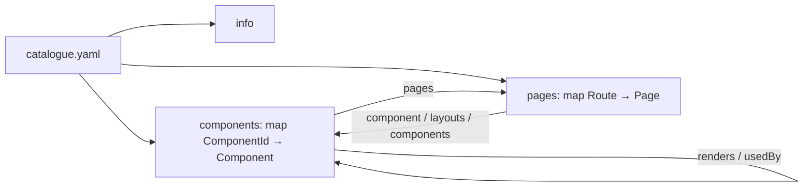
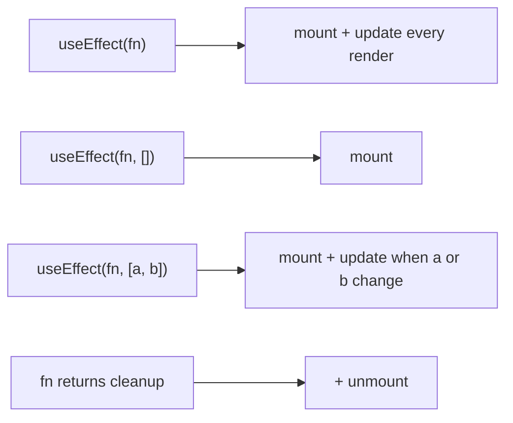

# CatalogueSpec 1.0

CatalogueSpec describes a React / Next.js frontend the way OpenAPI describes an HTTP API. A document is a single YAML (or JSON) file, `catalogue.yaml` by convention. It is generated by `rcat generate` and can be edited by hand. Human-owned fields survive regeneration.



The machine-readable definition is [`spec/catalogue.schema.json`](../spec/catalogue.schema.json). Editors with the YAML language server pick it up from the first-line comment the generator writes.

## Document root

| Field | Type | Req | Description |
|---|---|---|---|
| `catalogue` | string | yes | Spec version. `"1.0"`. |
| `info` | [Info](#info) | yes | Project metadata. |
| `components` | map<ComponentId, [Component](#component)> | yes | Every component found in the project. |
| `pages` | map<Route, [Page](#page)> | yes | Every routable page. |

Keys starting with `x-` are allowed on the root, `info`, every Component, Prop and Page. They are never touched by the generator (same convention as OpenAPI extensions).

## Identifiers

- **ComponentId**: the component's name (`Button`). If two components share a name, both become `Name@relative/file/path.tsx`.
- **Route**: the URL pattern as the router sees it. Next.js keeps its bracket syntax (`/blog/[slug]`, `/docs/[...path]`); React Router keeps its colon syntax (`/users/:id`). Route groups `(group)` and parallel slots `@slot` are stripped.

## Info

| Field | Type | Description |
|---|---|---|
| `title` | string | **Required.** From `catalogue.config.json` or `package.json` name. |
| `version` | string | From `package.json`. |
| `description` | string | Manual. |
| `framework` | `react` \| `next` | Detected from dependencies. |
| `routers` | array of `next-app` \| `next-pages` \| `react-router` | Routers found in the code. |
| `generator` | string | Tool and version that produced the file. |
| `generatedAt` | date-time | |

## Component

| Field | Type | Owner | Description |
|---|---|---|---|
| `name` | string | gen | Display name. |
| `file` | string | gen | Path relative to project root. |
| `line` | integer | gen | Declaration line. |
| `kind` | `function` \| `class` \| `memo` \| `forwardRef` | gen | How it is declared. `memo(forwardRef(...))` is `memo`. |
| `export` | `default` \| `named` \| `none` | gen | How the defining file exports it. |
| `description` | string | both | From the JSDoc block above the declaration; a hand-written value wins. |
| `status` | `experimental` \| `stable` \| `deprecated` | both | `@deprecated` in JSDoc sets `deprecated`. |
| `tags` | string[] | manual | Free-form grouping. |
| `owner` | string | manual | Team or person. |
| `props` | map<string, [Prop](#prop)> | gen | |
| `state` | map<string, [State](#state)> | gen | Local state only. |
| `context` | string[] | gen | Contexts read via `useContext` / `static contextType`. |
| `refs` | string[] | gen | `useRef` / `createRef` holders. |
| `hooks` | [Hook](#hook)[] | gen | Every hook called, deduplicated. |
| `lifecycle` | [LifecycleEvent](#lifecycleevent)[] | gen | Effects and class lifecycle methods. |
| `renders` | ComponentId[] | gen | Project components this one renders directly. |
| `externals` | string[] | gen | Library components rendered, as `module#Name` (`next/link#Link`). |
| `usedBy` | ComponentId[] | gen | Reverse of `renders`. |
| `pages` | Route[] | gen | Pages whose tree contains this component (directly or transitively, layouts included). |

### Prop

| Field | Type | Description |
|---|---|---|
| `type` | string | TypeScript type text, PropTypes validator, or `unknown`. |
| `required` | boolean | Not optional in the type, no default, or `.isRequired`. |
| `default` | string | Source text of the default value. |
| `description` | string | From the TS member's JSDoc; editable. |

### State

| Field | Type | Description |
|---|---|---|
| `source` | `useState` \| `useReducer` \| `class` | |
| `initial` | string | Source text of the initial value (truncated at 80 chars). |
| `setter` | string | `setX`, the dispatch name, or `this.setState`. |
| `type` | string | `useState<T>` generic or class `State` member type. |
| `reducer` | string | `useReducer` only. |

### Hook

| Field | Type | Description |
|---|---|---|
| `name` | string | `useEffect`, `useRouter`, `useCart`, … |
| `category` | `state` \| `effect` \| `context` \| `ref` \| `memo` \| `router` \| `data` \| `custom` | Built-ins and well-known library hooks are classified; everything else is `custom`. |
| `count` | integer | Calls in this component (omitted when 1). |

### LifecycleEvent

One entry per effect or class lifecycle method. `phases` says when it runs.

| Field | Type | Description |
|---|---|---|
| `via` | string | `useEffect`, `useLayoutEffect`, `useInsertionEffect`, `constructor`, `componentDidMount`, `componentDidUpdate`, `componentWillUnmount`, `shouldComponentUpdate`, `getDerivedStateFromProps`, `getSnapshotBeforeUpdate`, `componentDidCatch`, `getDerivedStateFromError`. |
| `phases` | (`mount` \| `update` \| `unmount` \| `error`)[] | |
| `deps` | string[] | Effects only. Absent = runs after every render; `[]` = mount only. |
| `calls` | string[] | Functions called in the body (`fetchUser`, `setUser`, `api.get`). |
| `cleanup` | string[] | Functions called in the effect's cleanup. Present ⇒ `unmount` is in `phases`. |
| `line` | integer | |

Effect → phases mapping:



## Page

| Field | Type | Owner | Description |
|---|---|---|---|
| `router` | `next-app` \| `next-pages` \| `react-router` | gen | |
| `file` | string | gen | File that declares the route (page file, or the file containing `<Route>`). |
| `component` | ComponentId | gen | Root component. Absent if unresolved. |
| `params` | string[] | gen | Dynamic segments. |
| `layouts` | ComponentId[] | gen | Outermost first: `layout.tsx` chain or `_app`. |
| `components` | ComponentId[] | gen | Every project component in the page tree, layouts included. |
| `description` | string | manual | |
| `tags` | string[] | manual | |

## Regeneration rules

`rcat generate` rewrites every `gen` field. It keeps from the previous file: `info.description`, component/page `description` (when present), `status` (unless JSDoc says deprecated), `tags`, `owner`, prop `description`, and every `x-*` key.

## Example

```yaml
# yaml-language-server: $schema=./node_modules/react-catalogue/spec/catalogue.schema.json
catalogue: "1.0"
info:
  title: shop-web
  version: 2.3.0
  framework: next
  routers: [next-app]
components:
  ProductCard:
    name: ProductCard
    file: src/components/ProductCard.tsx
    line: 12
    kind: memo
    export: default
    description: Card shown in product grids.
    tags: [catalog]
    owner: storefront-team
    props:
      product: { type: Product, required: true }
      onAdd: { type: "(id: string) => void", required: false }
      compact: { type: boolean, required: false, default: "false" }
    state:
      hovered: { source: useState, initial: "false", setter: setHovered }
    context: [CartContext]
    hooks:
      - { name: useState, category: state }
      - { name: useContext, category: context }
      - { name: useEffect, category: effect }
    lifecycle:
      - via: useEffect
        phases: [mount, update, unmount]
        deps: [product.id]
        calls: [trackImpression]
        cleanup: [cancelImpression]
        line: 20
    renders: [Price, AddToCartButton]
    externals: ["next/image#Image"]
    usedBy: [ProductGrid]
    pages: [/, /category/[slug]]
    x-figma: https://figma.com/file/abc
pages:
  /category/[slug]:
    router: next-app
    file: app/category/[slug]/page.tsx
    component: CategoryPage
    params: [slug]
    layouts: [RootLayout]
    components: [RootLayout, Header, CategoryPage, ProductGrid, ProductCard, Price, AddToCartButton]
```
