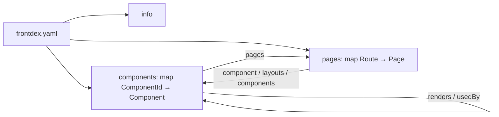
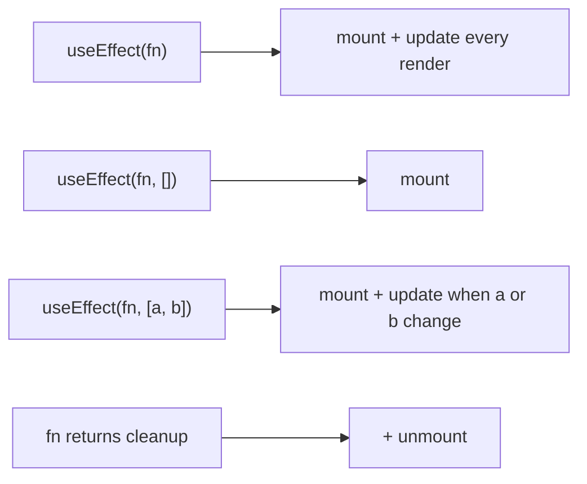

# CatalogueSpec 1.1

CatalogueSpec describes a React / Next.js frontend the way OpenAPI describes an HTTP API. A document is a single YAML (or JSON) file, `frontdex.yaml` by convention. It is generated by `frontdex generate` and can be edited by hand. Human-owned fields survive regeneration.



The machine-readable definition is [`spec/catalogue.schema.json`](../spec/catalogue.schema.json). Editors with the YAML language server pick it up from the first-line comment the generator writes.

## Document root

| Field | Type | Req | Description |
|---|---|---|---|
| `catalogue` | string | yes | Spec version: `"1.1"` (`"1.0"` documents remain valid). |
| `info` | [Info](#info) | yes | Project metadata. |
| `components` | map<ComponentId, [Component](#component)> | yes | Every component found in the project. |
| `pages` | map<Route, [Page](#page)> | yes | Every routable page. |
| `stores` | map<StoreId, [Store](#store)> | no | Global state: Redux slices, React contexts, zustand stores. |
| `styles` | map<file, [Stylesheet](#stylesheet)> | no | Every stylesheet in the project. |
| `endpoints` | map<key, Endpoint> | no | Server entry points the frontend defines. Key: the URL for route handlers, API routes and resource routes; `middleware`; `action:<name>` for server actions. Endpoint: `kind` (`route-handler` \| `api-route` \| `resource-route` \| `middleware` \| `server-action`), `file`, `methods`, `workspace`, `importedBy` (server actions). |
| `tokens` | object | no | `definitions`: map<token, { value, at, source: css \| tailwind }> from CSS custom properties and the Tailwind theme. `drift`: hard-coded values matching a token, each with `value`, `at` (where used), `property`, `token`, `defined` (where the token is), `match` (exact \| near) and `use` (what to write instead). |
| `duplicates` | array | no | Pairs of components that look alike: `components` [a, b], `score` 0–1, `reasons`. The less-used one also gets a `possible-duplicate` issue. |
| `hooks` | map<HookId, { file, line, reads, calls, usedBy }> | no | Custom hooks: the contexts/stores they read, hooks they call, components using them. HookId is the name, or `name@file` when names collide. |
| `health` | [Health](#health) | no | Issue totals and dead code. |
| `aliases` | map<OldId, CurrentId> | no | Former Component/Hook IDs that changed, so old references keep resolving. Chains are collapsed; an alias is dropped when its old ID is live again or its target is gone. |

**Sharded layout.** Large projects (`"shard": "auto"` above 500 components, or `"shard": true` in `frontdex.config.json`) store the same document as a folder named after the output file: `frontdex/index.yaml` holds every root field except `components`, plus `shards`, the list of component files; each `frontdex/components/<dir>.yaml` holds `components:` for one source folder (path cut at 4 segments, `/` written as `__`, root files in `_root.yaml`). `readCatalogue()` reassembles it. Once sharded, `auto` stays sharded; `"shard": false` returns to one file.

Keys starting with `x-` are allowed on the root, `info`, every Component, Prop and Page. They are never touched by the generator (same convention as OpenAPI extensions).

## Identifiers

- **ComponentId**: the component's name (`Button`), or `Name@relative/file/path.tsx` when the name was shared at the time the component was first recorded. IDs are stable: a rescan keeps every ID the previous document holds (matched by name and file), so adding a second `Button` elsewhere gives only the newcomer a qualified ID. A cold scan with no previous document qualifies every holder of a shared name. HookIds follow the same rules.
- **Aliases**: when an ID does change (a component's file moved and its ID embedded the old path), `aliases` maps the old ID to the new one. A file move with a bare ID keeps the ID and needs no alias.
- **Route**: the URL pattern as the router sees it. Next.js keeps its bracket syntax (`/blog/[slug]`, `/docs/[...path]`); React Router keeps its colon syntax (`/users/:id`). Route groups `(group)` and parallel slots `@slot` are stripped.

## Info

| Field | Type | Description |
|---|---|---|
| `title` | string | **Required.** From `frontdex.config.json` or `package.json` name. |
| `version` | string | From `package.json`. |
| `description` | string | Manual. |
| `framework` | `react` \| `next` | Detected from dependencies (any workspace package counts). |
| `packageManager` | `npm` \| `pnpm` \| `yarn` \| `yarn-berry` \| `yarn-pnp` \| `bun` | From the `packageManager` field or the lockfile. |
| `workspaces` | string[] | Workspace package names (monorepos only). |
| `routers` | array of `next-app` \| `next-pages` \| `react-router` \| `react-router-v7` \| `remix` \| `tanstack` \| `gatsby` \| `solid-start` \| `qwik-city` | Routers found in the code. |
| `generator` | string | Tool and version that produced the file. |
| `generatedAt` | date-time | |

## Component

| Field | Type | Owner | Description |
|---|---|---|---|
| `name` | string | gen | Display name. |
| `file` | string | gen | Path relative to project root. |
| `workspace` | string | gen | Workspace package containing the component (monorepos only). |
| `line` | integer | gen | Declaration line. |
| `kind` | `function` \| `class` \| `memo` \| `forwardRef` | gen | How it is declared. `memo(forwardRef(...))` is `memo`; Qwik `component$()` is `function`. |
| `rendering` | `client` \| `server` | gen | Next.js App Router pages only: `client` when the module, or a component that renders it, has `'use client'`. |
| `export` | `default` \| `named` \| `none` | gen | How the defining file exports it. |
| `description` | string | both | From the JSDoc block above the declaration; a hand-written value wins. |
| `status` | `experimental` \| `stable` \| `deprecated` | both | `@deprecated` in JSDoc sets `deprecated`. |
| `tags` | string[] | manual | Free-form grouping. |
| `owner` | string | manual | Team or person. |
| `codeowners` | string[] | gen | Owners from `CODEOWNERS` at the project root (last matching rule). |
| `tests` | string[] | gen | Test files for the component (`X.test.*`, `X.spec.*`, `__tests__/X.*`), relative to its folder. |
| `stories` | string[] | gen | Story files (`X.stories.*`), relative to its folder. |
| `props` | map<string, [Prop](#prop)> | gen | |
| `state` | map<string, [State](#state)> | gen | Local state only. |
| `context` | string[] | gen | Contexts read via `useContext` / `static contextType`. |
| `refs` | string[] | gen | `useRef` / `createRef` holders. |
| `hooks` | [Hook](#hook)[] | gen | Every hook called, deduplicated. |
| `lifecycle` | [LifecycleEvent](#lifecycleevent)[] | gen | Effects and class lifecycle methods. |
| `variables` | [Variable](#variable)[] | gen | Locals declared in the component body (non-hook). |
| `functions` | [Function](#function)[] | gen | Inner functions, handlers, `useCallback`s, class methods. |
| `timers` | [Timer](#timer)[] | gen | Intervals, timeouts, listeners, subscriptions, observers, sockets, and whether each is released. |
| `apiCalls` | [ApiCall](#apicall)[] | gen | `fetch`, axios-style clients, `useSWR`/`useQuery`, calls into API/service modules. |
| `store` | `{ reads: StoreRead[], writes: StoreWrite[] }` | gen | Redux (`useSelector`, `dispatch`, `connect`), context (`useContext`, custom hooks) and zustand usage. |
| `validation` | [Validation](#validation)[] | gen | zod / yup schemas (also imported ones), react-hook-form rules, HTML constraints, custom validators. |
| `styles` | `{ classes, modules, sheets }` | gen | Class names with the `file:line` that defines them, CSS-module classes, imported stylesheets. |
| `issues` | [Issue](#issue)[] | gen | Diagnostics for this component. |
| `passes` | map<ComponentId, `{name, value, line}`[]> | gen | Props this component passes to each child, with the source text of each value. |
| `renders` | ComponentId[] | gen | Project components this one renders directly. |
| `externals` | string[] | gen | Library components rendered, as `module#Name` (`next/link#Link`). |
| `usedBy` | ComponentId[] | gen | Reverse of `renders`. |
| `pages` | Route[] | gen | Pages whose tree contains this component (directly or transitively, layouts included). |

### Prop

| Field | Type | Description |
|---|---|---|
| `type` | string | TypeScript type text, PropTypes validator, or `unknown`. |
| `required` | boolean | Not optional in the type, no default, or `.isRequired`. |
| `default` | string | Source text of the default value. |
| `description` | string | From the TS member's JSDoc; editable. |

### State

| Field | Type | Description |
|---|---|---|
| `source` | `useState` \| `useReducer` \| `class` | |
| `initial` | string | Source text of the initial value (truncated at 80 chars). |
| `setter` | string | `setX`, the dispatch name, or `this.setState`. |
| `type` | string | `useState<T>` generic or class `State` member type. |
| `reducer` | string | `useReducer` only. |

### Hook

| Field | Type | Description |
|---|---|---|
| `name` | string | `useEffect`, `useRouter`, `useCart`, … |
| `category` | `state` \| `effect` \| `context` \| `ref` \| `memo` \| `router` \| `data` \| `custom` | Built-ins and well-known library hooks are classified; everything else is `custom`. |
| `count` | integer | Calls in this component (omitted when 1). |

### LifecycleEvent

One entry per effect or class lifecycle method. `phases` says when it runs.

| Field | Type | Description |
|---|---|---|
| `via` | string | `useEffect`, `useLayoutEffect`, `useInsertionEffect`, `constructor`, `componentDidMount`, `componentDidUpdate`, `componentWillUnmount`, `shouldComponentUpdate`, `getDerivedStateFromProps`, `getSnapshotBeforeUpdate`, `componentDidCatch`, `getDerivedStateFromError`. |
| `phases` | (`mount` \| `update` \| `unmount` \| `error`)[] | |
| `deps` | string[] | Effects only. Absent = runs after every render; `[]` = mount only. |
| `calls` | string[] | Functions called in the body (`fetchUser`, `setUser`, `api.get`). |
| `cleanup` | string[] | Functions called in the effect's cleanup. Present ⇒ `unmount` is in `phases`. |
| `line` | integer | |

Effect → phases mapping:



## Insights (1.1)

### Variable

`{ name, kind: const|let|var|memo|field, value, line, used }`. `used: false` also produces an `unused-variable` issue.

### Function

`{ name, kind: handler|helper|method, async, params, calls[], sets[], used, memoized }`. `sets` lists the state fields whose setters it calls.

### Timer

`{ type, call, event, in, line, cleared }`.

- `type`: `interval` · `timeout` · `animation-frame` · `idle-callback` · `listener` · `subscription` · `observer` · `socket`
- `in`: where it starts, e.g. `useEffect L12`, `componentDidMount`, `handler handleClick` or `render`
- `cleared`:
  - `true`: the effect cleanup or `componentWillUnmount` releases it
  - `false`: it is never released
  - `null`: a one-shot timeout in a handler

### ApiCall

`{ via, method, target, module, in, line }`. `via` is `fetch`, `http.get`, `useSWR`, `useQuery`, `service`, etc.; `target` is the URL or key text.

### Validation

`{ via, schema | field | fn, rules[], line }`. `via` is `zod`, `yup`, `react-hook-form`, `html` or `custom`.

### Issue

`{ type, severity: high|medium|low|info, message, line, fix }`.

| Type | Severity | Detected when |
|---|---|---|
| `memory-leak` | high / medium | An interval, listener, subscription, observer or socket is started in an effect or mount method without a matching release. A timeout in an effect without `clearTimeout` is medium. |
| `render-loop` | high | An effect with no dependency array calls a state setter unconditionally. |
| `side-effect-in-render` | high | A timer or listener is started directly during render. |
| `unsafe-async-update` | medium | An effect sets state after `await` / `.then` / a request, with no cleanup or abort. |
| `missing-dependency` | low | An effect reads props, state or locals that are missing from its dependency array. |
| `unused-variable`, `unused-function`, `unused-prop`, `unused-state` | low | Declared but never referenced (Babel scope analysis). |
| `state-never-updated` | info | The state setter is never called. |
| `deprecated-usage` | medium | The component renders one marked `@deprecated`. |

### Store

`{ kind: redux-slice|context|zustand, name, file, line, key, state[], actions[], thunks[], default, readers[], writers[], providers[] }`.

- **Ids:** `redux:<slice>`, `context:<Name>`, `zustand:<useHook>`.
- **Redux readers** are matched through the `configureStore` reducer key.
- **Writers** are matched through slice actions and thunks.
- **Context readers** include components that read the context through custom hooks (`useAuth()` → `AuthContext`).

### Stylesheet

`{ module, classes (count), importedBy[] }`.

### Health

`{ issues: {high, medium, low, info}, byType, unusedComponents[], unusedExports[{file,name}], unusedFiles[], unusedImports[{file,name,source,line}] }`.

- **Exempt from the unused checks:** framework entry files, i.e. Next special files, `pages/`, files declaring routes, and `main`/`index`.
- **Type-only imports** count as usage.

## Page

| Field | Type | Owner | Description |
|---|---|---|---|
| `router` | see `info.routers` | gen | Params keep the router's syntax: `[id]` (Next, Gatsby, SolidStart, Qwik), `:id` (React Router, Remix), `$id` (TanStack). |
| `file` | string | gen | File that declares the route (page file, or the file containing `<Route>`). |
| `workspace` | string | gen | Workspace package serving the page (monorepos only). When two apps serve the same route, the second page is keyed `<route> (<workspace>)`. |
| `component` | ComponentId | gen | Root component. Absent if unresolved. |
| `params` | string[] | gen | Dynamic segments. |
| `layouts` | ComponentId[] | gen | Outermost first: `layout.tsx` chain, `_app`, `root.tsx` + parent routes (Remix/React Router), `__root` + parent routes (TanStack). |
| `metadata` | `static` \| `dynamic` | gen | Next.js: the page exports `metadata` (static) or `generateMetadata` (dynamic). |
| `components` | ComponentId[] | gen | Every project component in the page tree, layouts included. |
| `description` | string | manual | |
| `tags` | string[] | manual | |

## Regeneration rules

`frontdex generate` rewrites every `gen` field. It keeps from the previous file: `info.description`, component/page `description` (when present), `status` (unless JSDoc says deprecated), `tags`, `owner`, prop `description`, and every `x-*` key.

## Example

```yaml
# yaml-language-server: $schema=./node_modules/frontdex/spec/catalogue.schema.json
catalogue: "1.0"
info:
  title: shop-web
  version: 2.3.0
  framework: next
  routers: [next-app]
components:
  ProductCard:
    name: ProductCard
    file: src/components/ProductCard.tsx
    line: 12
    kind: memo
    export: default
    description: Card shown in product grids.
    tags: [catalog]
    owner: storefront-team
    props:
      product: { type: Product, required: true }
      onAdd: { type: "(id: string) => void", required: false }
      compact: { type: boolean, required: false, default: "false" }
    state:
      hovered: { source: useState, initial: "false", setter: setHovered }
    context: [CartContext]
    hooks:
      - { name: useState, category: state }
      - { name: useContext, category: context }
      - { name: useEffect, category: effect }
    lifecycle:
      - via: useEffect
        phases: [mount, update, unmount]
        deps: [product.id]
        calls: [trackImpression]
        cleanup: [cancelImpression]
        line: 20
    renders: [Price, AddToCartButton]
    externals: ["next/image#Image"]
    usedBy: [ProductGrid]
    pages: [/, /category/[slug]]
    x-figma: https://figma.com/file/abc
pages:
  /category/[slug]:
    router: next-app
    file: app/category/[slug]/page.tsx
    component: CategoryPage
    params: [slug]
    layouts: [RootLayout]
    components: [RootLayout, Header, CategoryPage, ProductGrid, ProductCard, Price, AddToCartButton]
```
