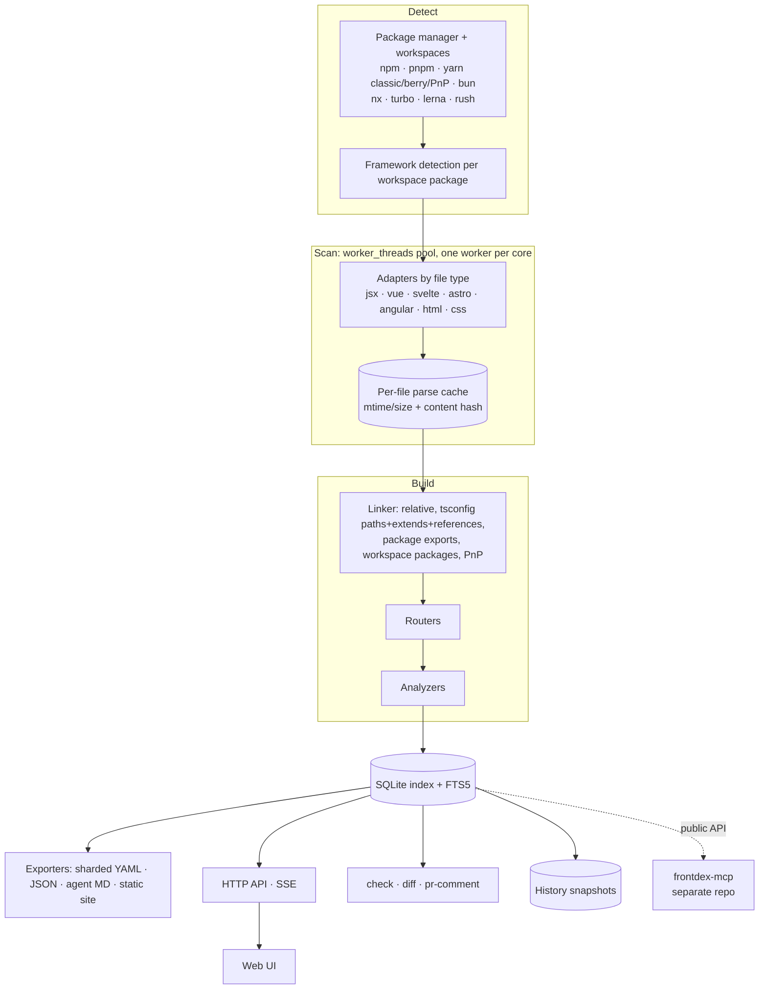

# Task: Frontdex 1.0

One task, delivered in one go. Ordering inside it is dependency order, not release phases: nothing ships until every acceptance criterion at the end passes.

## Baseline findings (2026-10-19)

Measured on this machine (Node 24.21, Windows) with `bench/scan.js` (the Next example copied 20× = 1,720 files) and a CPU profile of the same run.

| Measure | Result | 1.0 target |
|---|---|---|
| Cold scan | 14.2 s (8.2 ms/file) | < 15 s at 20k files |
| Babel parse share of the cold scan | **7%** | – |
| No-change rescan | 1.4 s | – |
| One-file rescan | 2.2 s | < 300 ms |
| RSS | 439 MB | < 1 GB at 20k |

Same benchmark at 250 copies (21,500 files): cold scan 109.2 s (5.1 ms/file, parse 6%), no-change rescan 11.6 s, one-file rescan 17.7 s, RSS 1,165 MB. Every 20k target is missed, rescans by ~60×.

Parser comparison on the 124 source files in this repo (`oxc-parser` 0.154.0, warm, 20 runs):

| | ms/file |
|---|---|
| Babel parse | 0.56 |
| Babel parse + scope crawl | 2.78 |
| oxc parse | 0.11 (5× faster than Babel) |
| oxc parse + `eslint-scope` | 1.62, and `eslint-scope` failed on every TSX/JSX file |

What this changes:

- **The oxc swap does not pay for itself.** Parsing is 7% of a scan, so even an infinitely fast parser saves at most 7%. oxc has no JS-side scope analysis, and the scanner depends on Babel scopes (`binding.referenced`, `NodePath`) throughout `insights.js` and `component.js`, so the port would be a rewrite of ~1,900 lines for a single-digit gain. **Babel stays.** Revisit only if traversal itself is replaced.
- **The real costs are I/O and whole-project recomputation:** two full directory walks per scan (sources, then stylesheets) with a `stat` per entry, stylesheets re-read every scan, the full parse cache and catalogue mirror re-read and deserialised every scan, and linking, insights, YAML and agent cards recomputed for every file on a one-file change.
- `node:sqlite` with FTS5 works here; unflagged since Node 22.13 / 23.4 ([Node docs](https://nodejs.org/api/sqlite.html)). Still marked experimental (release candidate in 25.x).
- `oxc-parser` ships per-platform binaries through `optionalDependencies` (confirmed: `@oxc-parser/binding-win32-x64-msvc` installed, no install script). The pattern for C2 is sound if a native dependency is ever added.
- The committed agent cards of both examples were stale (card format changed, catalogue did not). Fixed in `001ca89`; `test/golden.test.js` now guards it.

## Goal

Turn `react-catalogue` into **Frontdex** (`frontdex`): a devDependency installed inside the user's app that reads the source of any mainstream frontend (React family, Vue, Svelte, Astro, Angular, plain HTML), keeps a living, never-stale knowledge base of components, pages, state, APIs, styles, tokens and health, and serves it to developers (CLI, UI, CI) and to coding agents (rules, hooks, and a separately-packaged MCP server).

Positioning: *Storybook needs you to write stories. We read your code.*

## Decisions taken

Decisions marked **default** were left open in discussion. They are applied here so the task can run in one go; change them before starting if they are wrong.

| Decision | Value |
|---|---|
| Distribution | In-app devDependency. Not a standalone app, not a SaaS. Nothing leaves the machine. |
| Name | Product **Frontdex**: an index of everything in a frontend ("-dex" as in index / Pokédex). Framework-neutral. Checked 2026-10-19: `frontdex` and `frontdex-mcp` free on npm, no product of that name on the web, only three 0-star personal GitHub repos. `uiatlas` was dropped because UI-Atlas is an existing open-source UI-mapping tool for agents (too close in concept). |
| Repos | Two repos: `frontdex` (the package; the existing `frontend-catalog` GitHub repo is renamed, GitHub keeps a redirect) and `frontdex-mcp` (new). |
| Package names | `frontdex` (bin `frontdex`, aliases `fdx` and `rcat` for migration) and `frontdex-mcp`. Config `frontdex.config.json`, knowledge dir `.frontdex/`, output `frontdex.yaml`. MCP tool names keep the `catalogue_` prefix so existing agent rules keep working. Old name `react-catalogue` gets a final release that re-exports the new package and prints a rename notice. |
| Language | TypeScript, ESM, Node ≥ 22.13 (first line with unflagged `node:sqlite`; verify at start). Also runs on Bun. |
| JS/TS parser | `oxc-parser` (Rust, prebuilt per-platform binaries). Replaces `@babel/parser` + `@babel/traverse`. |
| Framework parsers | Official compilers, as optional peer deps loaded only when detected: `@vue/compiler-sfc`, `svelte/compiler`, `@astrojs/compiler`, `@angular/compiler`. HTML via `parse5`, CSS via `lightningcss`. |
| Index | `node:sqlite` with FTS5, at `.frontdex/index.db` (git-ignored). |
| UI | React + Vite + TanStack Router + TanStack Virtual, **pre-built at publish time** and shipped as static assets, so the user's own React version is never touched. |
| Licence / hosting | **default** MIT, open source, local only. No hosted hub. |
| GitHub owner | `Prathmesh2000`, both repos **public**. Requires `gh auth login` as `Prathmesh2000` (the default `gh` account `prathmesh_altpath` has no admin rights on it). |

## Hard constraints

These come from the research done for this task (sources at the end). Every one is checked in acceptance.

| # | Constraint | Reason |
|---|---|---|
| C1 | No `postinstall` or any lifecycle script. | pnpm 10 blocks dependency lifecycle scripts by default; a blocked postinstall leaves users with a broken binary. |
| C2 | Native code only through per-platform `optionalDependencies` (the esbuild / napi-rs pattern). Works under Yarn PnP. | Same as C1; PnP keeps binaries inside a zip. |
| C3 | Next.js integration must not use webpack plugins. | Turbopack does not run webpack plugins. |
| C4 | Zero bytes in the user's production bundle. Any runtime overlay is imported only behind `NODE_ENV === 'development'`. | The package lives in the app repo. |
| C5 | Workspaces and monorepos are first-class from the start. | Most real codebases are monorepos; Knip and Omlet both treat this as table stakes. |
| C6 | Zero-config by default. `npx frontdex init` detects package manager, workspaces and frameworks; config only overrides. | Ladle and Knip win on this; Storybook loses on setup and upgrade pain. |
| C7 | React/Next output stays at least as rich as today. Golden-file tests on both examples guard it. | No regressions while rewriting. |

## Target architecture



Incremental by design: a file change re-parses that file only, re-links only the modules whose resolved imports touch it, and re-runs only the analyzers whose inputs changed.

## Repo 1: `frontdex` (the package)

Converted to a pnpm workspace internally so code stays organised, but published as **one** npm package (`frontdex`) with subpath exports. Internal packages are bundled at build time, not published separately.

```
packages/
  spec/          CatalogueSpec 2.0 TypeScript types + JSON Schema
  core/          config, detection, linker, graph, SQLite index, history, public API
  adapters/      jsx/ vue/ svelte/ astro/ angular/ html/ css/
  routers/       one file per router
  analyzers/     health/ a11y/ tokens/ dupes/ adoption/ perf/ tests/ owners/ i18n/
  cli/           `frontdex`
  server/        HTTP + SSE
  ui/            React app, built to static files
  integrations/  next.cjs, vite.ts, webpack.ts, rspack.ts, github-action/
examples/        next-app, react-app (existing) + one per new framework
test/            golden files, fixtures, unit tests
```

Published `exports`: `.` (public API), `./next`, `./vite`, `./webpack`, `./rspack`, `./query`, `./schema.json`, `./overlay` (dev-only runtime overlay).

### Public API (consumed by the MCP repo; semver-guarded)

`loadConfig`, `scan`, `openIndex` (query handle over SQLite), `readCatalogue`, `createHistory`, `componentCard`, `formatSummary`, `formatDetail`, `query`, `impact`, `dataflow`, plus the spec types. Anything not exported here is internal and may change in any release.

### Package managers and repos

| Need | Support |
|---|---|
| Install | npm, pnpm, yarn classic, yarn berry (node_modules and PnP), bun |
| Run without install | `npx`, `pnpm dlx`, `yarn dlx`, `bunx` |
| Workspaces | `package.json` workspaces, `pnpm-workspace.yaml`, yarn/bun workspaces, nx, turbo, lerna, rush |
| Resolution | relative paths, tsconfig `paths` + `extends` chains + project references, `package.json` `exports`/`imports` fields, workspace package names (`@acme/ui` → source, not `dist`), Yarn PnP API when present |

### Frameworks: adapters and routers

| Framework | Adapter | Router / pages |
|---|---|---|
| React (CRA, Vite, Parcel, Rsbuild) | jsx | React Router v6 JSX + object routes (existing) |
| Next.js | jsx | App Router (existing, add RSC `'use client'` boundary, server actions, route handlers, middleware, metadata), Pages Router (existing) |
| React Router v7 framework mode / Remix v2 | jsx | `app/routes.ts`, flat-file routes, loaders/actions |
| TanStack Router / Start | jsx | `src/routes` file routes, `createFileRoute`, code routes |
| Gatsby | jsx | `src/pages` |
| Preact | jsx | as React; `preact/hooks` |
| SolidJS / SolidStart | jsx | `createSignal`/`createStore` = state, `onCleanup` = cleanup, `src/routes` |
| Qwik / Qwik City | jsx | `component$`, `useSignal`, `src/routes` |
| Vue / Nuxt | vue | Vue Router config, Nuxt `pages/`, `layouts/`; Pinia/Vuex stores |
| Svelte / SvelteKit | svelte | `src/routes/+page.svelte`, `+layout`, `+page.ts` loaders; stores, runes |
| Astro | astro | `src/pages`, layouts, islands (each island resolved through its own adapter) |
| Angular | angular | `@Component` + templates, `Routes` arrays, standalone and NgModule; NgRx |
| Lit / Web Components | jsx (TS/JS) | `customElements.define`, `@customElement`; no router |
| Plain HTML (+ Alpine, htmx, Stimulus) | html | `.html` files routed by path; components = `<template>`, custom elements, Alpine `x-data` blocks, repeated partials |

Every adapter produces the same module shape (imports, exports, components, routes, state, effects, API calls, styles, validation) so linker, analyzers, UI and MCP stay framework-agnostic. Analyzers that are React-specific (render loops, hook deps) declare which adapters they apply to.

### Styles

Plain CSS, CSS modules, SCSS/Less (through lightningcss, nesting included), Tailwind (classes resolved against the project's Tailwind config and theme), styled-components, Emotion, vanilla-extract, Panda, UnoCSS. Replaces the regex parser in `src/scanner/project.js`.

### Analyzers

| Analyzer | Output |
|---|---|
| health (existing) | leaks, render loops, unsafe async, stale deps, dead code. Ported to oxc with no loss. |
| dupes | Near-duplicate components by name similarity + prop-shape overlap + JSX structure hash (e.g. `Button` vs `LegacyButton`, the two `Card`s in the Next example). |
| adoption | Usage count per component and per prop, deprecated component/prop usage, trend over history. Replaces the DIY react-scanner → BI pipelines teams build today. |
| tokens | Tokens from CSS variables, Tailwind theme, theme objects. Drift = hardcoded value near a token, reported with two pieces of evidence: the token definition and the offending usage. |
| a11y | Static jsx-a11y-class checks: missing alt, unlabeled controls, click on non-interactive elements, missing form labels. |
| i18n | Hardcoded user-facing strings in markup when an i18n library is present. |
| perf | Import cost per component and page (resolved dependency size), heavy dependencies, client/server boundary size for Next. |
| tests | Whether a test or story exists per component; coverage % when an istanbul/v8 report is present. |
| owners | `CODEOWNERS` match, git last-modified, churn, top contributors. |

### Visual layer

- Read existing `*.stories.*` (CSF) and `*.fixture.*` (React Cosmos) as variants. Remove `**/*.stories.*` from the default exclude list; stories are indexed as examples, not as components.
- Read a Storybook components manifest when present.
- Isolated preview served **through the user's own dev server** so their providers and CSS apply: Vite plugin adds a virtual route `/__frontdex/preview/:id`; Next integration generates a git-ignored dev-only route file under `app/__frontdex/` (no webpack plugin, C3). Providers come from an optional `frontdex.preview.tsx` decorators file.
- Props playground on top of the preview, controls generated from prop types.
- `frontdex screenshot` with Playwright as an optional peer dependency; screenshots are stored in history so snapshots can be diffed visually.

### Storage and output

- `node:sqlite` index is the source of truth for queries. UI, CLI and MCP never load the whole catalogue into memory.
- Human output: `frontdex.yaml` becomes a small root index plus shards `frontdex/<workspace>/<dir>.yaml`, so two PRs touching different folders never conflict. `"output": { "shard": false }` keeps the single-file mode.
- Stable component IDs: `<relative/file/path>#<ExportName>`; the display name is a separate field. Renaming a sibling never changes another component's ID.
- Agent output (`.frontdex/agent/`) is kept, sharded the same way.
- History is kept as is (content-addressed, packed), now keyed by stable IDs.

### CatalogueSpec 2.0

Breaking bump because of stable IDs. Adds `info.frameworks[]`, `info.packageManager`, `info.workspaces[]`, a `workspace` field on components and pages, `hooks` (custom hooks catalogued in their own right), `tokens`, `stories`, `owners`, `adoption`, `a11y`, and new router and component-kind enum values. `frontdex upgrade` migrates 1.x documents and keeps all hand-written fields (`description`, `tags`, `owner`, `x-*`). Update `docs/SPEC.md` and the JSON Schema.

### Configuration (`frontdex.config.json`, every key optional)

```jsonc
{
  "title": "shop-web",
  "include": ["."],
  "exclude": ["**/node_modules/**", "**/dist/**"],
  "workspaces": "auto",                 // or an explicit list
  "frameworks": "auto",                 // or ["next", "vue", ...]
  "output": { "file": "frontdex.yaml", "shard": true },
  "port": 4400,
  "preview": "http://localhost:3000",
  "autoUpdate": true,
  "knowledgeDir": ".frontdex",
  "history": { "enabled": true, "limit": 500 },
  "agents": { "enabled": true },
  "analyzers": { "a11y": true, "i18n": "auto", "perf": true, "tokens": { "sources": "auto" } },
  "ci": { "failOn": "high", "comment": true }
}
```

### CLI (`frontdex`, aliases `fdx`, `rcat`)

Global flags on every command: `-C <dir>`, `--json`, `--workspace <name>`, `--production` (ignore test/story/dev-only files).

| Group | Commands |
|---|---|
| Setup | `init` (interactive detection, writes config), `doctor` (what was detected, what was not, why), `agents [--targets] [--no-hooks] [--no-mcp] [--remove]`, `upgrade` (config + spec migration) |
| Scan | `scan [--full] [-m msg]`, `watch`, `check` (stale = exit 1), `validate` |
| Explore | `query "<filters>"`, `show <C>`, `impact <C>`, `dataflow <C>`, `routes`, `hooks`, `state [store]`, `api [endpoint]`, `styles [C]` |
| Design system | `tokens`, `dupes`, `adoption [C]` |
| Quality | `health [type] [--severity] [--strict]`, `a11y`, `perf`, `coverage`, `owners`, `fix` (safe automatic fixes: unused imports, exact token replacements) |
| Change | `history [id]`, `diff <refA> <refB>`, `pr-comment` |
| Visual | `preview <C>`, `screenshot [route]` |
| Output | `serve`, `build [-o dir]`, `export --format yaml\|json\|md\|html` |

`frontdex mcp` stays as a shim: runs `frontdex-mcp` if installed, otherwise prints the install command for the detected package manager.

Query language: keep every existing filter and add `fw:vue`, `ws:@acme/ui`, `token:color-primary`, `dupe:Button`, `owner:@team`, `has:story`, `is:duplicate`, `a11y:alt`.

### UI

```
┌──────────────────────────────────────────────────────────────────────────┐
│ ◧ shop-web ▾  [workspace ▾]  🔍 Ctrl K search…  snapshot: HEAD ▾  ⟳ Rescan │
├──────────────┬───────────────────────────────────────────┬───────────────┤
│ Overview     │  /checkout                     next-app   │ Source /      │
│ Routes       │  Tabs: Structure · Data · Preview ·       │ Live preview  │
│ Components   │        Health · A11y · Perf · History     │ drawer        │
│ Hooks        │                                           │ (file:line,   │
│ Design system│  layout tree / data-flow graph /          │  open in      │
│  Tokens      │  virtualized tables                       │  VS Code)     │
│  Duplicates  │                                           │               │
│  Adoption    │                                           │               │
│ Data         │                                           │               │
│  State · API │                                           │               │
│ Quality      │                                           │               │
│ Changes      │                                           │               │
│ Owners       │                                           │               │
└──────────────┴───────────────────────────────────────────┴───────────────┘
```

- Every existing view keeps its features: the page-first tree, component tabs (Data flow, Family, Internals, Lifecycle, API & state, Styles, Health, Source, History), the Ctrl K search, the live Rescan.
- Overview: framework mix, counts per workspace, health trend, adoption trend, "what to do next".
- All lists are virtualized and paged from the HTTP API (`/api/components?cursor=`, `/api/search?q=`, …). No `window.__CATALOGUE__` blob.
- `frontdex build` produces the same UI as a static site (the index is exported as JSON shards loaded on demand).
- Light and dark themes; keyboard navigation; passes its own a11y analyzer.

### Agent integration (stays in repo 1)

- Rules for Claude Code, Cursor, OpenCode, Hermes, Copilot and `AGENTS.md`, as today, plus a new rule: **run the duplicate check before creating a component**.
- `PostToolUse` / `SessionStart` hooks as today, now also reporting new duplicates and token drift introduced by the edit.
- `frontdex agents` writes the MCP entry as `npx frontdex-mcp` (or the pnpm/yarn/bun equivalent) and warns when the MCP package is not installed.

### CI

- `frontdex check` and `frontdex health --strict` as today.
- `frontdex diff` between two git refs: changed components, props, pages, new issues, adoption deltas.
- `frontdex pr-comment`: posts or updates one PR comment ("this PR changes `ProductCard` props; 5 pages affected; 2 new high-severity issues").
- A GitHub Action wrapping both, in `integrations/github-action/`, with a cache keyed by commit so CI only re-parses changed files.

### Optional dev-only overlay

`frontdex/overlay`: hover any element in the running app to see its component, file:line, props and render count, with a jump into the catalogue UI. Imported only under `NODE_ENV === 'development'` (C4); the Next and Vite integrations inject it automatically when `"overlay": true`.

## Repo 2: `frontdex-mcp`

```
package.json      name frontdex-mcp, bin frontdex-mcp,
                  peerDependencies { "frontdex": "^1.0.0" }, no other runtime deps
bin/              entry: loadConfig(cwd or -C) → start stdio server
src/server.ts     protocol: stateless 2026-07-28 revision + older initialize-handshake revisions (as today)
src/tools/        one file per tool
test/             protocol tests + tool tests against repo 1's examples
README.md         install with each package manager, register in Claude Code / Cursor / OpenCode / Hermes
```

Installed as a devDependency next to the package. The peer dependency guarantees the MCP server reads the index through the same version that wrote it.

Tools: the existing 12 (`catalogue_search`, `catalogue_component`, `catalogue_dataflow`, `catalogue_impact`, `catalogue_page`, `catalogue_state`, `catalogue_api`, `catalogue_styles`, `catalogue_health`, `catalogue_overview`, `catalogue_rescan`, `catalogue_history`), unchanged in name and output shape, plus:

| New tool | Purpose |
|---|---|
| `catalogue_find_existing` | Given a description or a planned component name/props, return existing candidates with similarity reasons. The tool the duplicate-check rule points at. |
| `catalogue_duplicates` | Known duplicate clusters. |
| `catalogue_tokens` | Tokens and current drift. |
| `catalogue_adoption` | Usage of a component or prop over time. |
| `catalogue_hooks` | Custom hooks and their callers. |
| `catalogue_diff` | Changes between two refs or snapshots. |

All tools read through the public API (`openIndex`), never from internal files.

## Work order

Dependency order. Tick every box; nothing is released until all are ticked.

**Baseline**
- [x] `npm install`, `npm test` green on today's code.
- [x] Record golden outputs: `catalogue.json`, agent cards and MCP responses for both examples. Done as `test/golden.test.js` against the committed example output; MCP responses are asserted in frontdex-mcp.
- [x] Verify at start: `oxc-parser` API stability and platform coverage, `node:sqlite` unflagged Node version, current Next/Turbopack plugin surface. Record findings at the top of this file.
- [ ] (GitHub done: repo renamed to `frontdex`, `origin` updated, `frontdex-mcp` created. npm placeholders still blocked on 2FA for the npm account.) **Confirm with the user**, then reserve the names before any other public step: publish `0.0.0` placeholders of `frontdex` and `frontdex-mcp` to npm, rename the GitHub repo `frontend-catalog` → `frontdex`, update the local `origin` remote. If either npm name has been taken since 2026-10-19, stop and ask.

**Foundation**
- [ ] Convert repo 1 to a TypeScript pnpm workspace with the layout above; build to one published package.
- [ ] `packages/spec`: types + Schema 2.0; `frontdex validate` passes on 1.x and 2.0 documents.
- [x] ~~Port the JSX scanner from Babel to oxc~~ dropped (see Baseline findings). Done instead: single directory walk, stylesheet cache, watch sessions with deferred YAML, worker-thread parsing; "keep last good parse" kept.
- [ ] Memory: < 1 GB at 20k files (stop cloning every cached module per scan; avoid double JSON serialisation of the catalogue).
- [ ] Re-measure at 20k files; the one-file rescan target applies to watch mode.
- [ ] Golden files for both examples match (allowed differences: ID format, new fields).
- [ ] SQLite index + FTS5; `query`, `show`, `impact`, `dataflow` read from it.
- [ ] Stable IDs; sharded YAML; history keyed by stable IDs; `frontdex upgrade` migrates the examples' 1.x files.

**Reach**
- [x] Package-manager and workspace detection; linker for tsconfig `extends`, `exports`, workspace packages, PnP (nothing resolves through node_modules). Not done: tsconfig project `references`.
- [x] New monorepo example (pnpm workspace: `apps/web` Next + `apps/admin` Vite + `packages/ui`) with cross-package usage.
- [x] Routers: RR v7/Remix, TanStack, Gatsby, SolidStart, Qwik City, plus Next RSC rendering/server actions/route handlers/middleware/metadata (`endpoints`, `rendering`, `client-code-in-server-component`). Not done: Solid `createSignal`/Qwik `useSignal` as state, middleware `matcher`.
- [x] Adapters + routers: Vue/Nuxt, Svelte/SvelteKit, Astro, Angular, Lit/Web Components, HTML (+ Alpine/htmx/Stimulus). Not done: Pinia/Svelte stores, Nuxt auto-imported components, NgRx.
- [x] One fixture per framework (in-test fixtures in `test/routers.test.js` and `test/adapters.test.js`), each asserting pages, components, state and API calls.
- [ ] Styles: lightningcss, Tailwind, CSS-in-JS.

**Insight**
- [ ] Analyzers: dupes, adoption, tokens, a11y, i18n, perf, tests, owners; health ported with no loss.
- [ ] CSF / fixture / Storybook-manifest ingestion.
- [ ] `fix` for the safe automatic cases.

**Surfaces**
- [ ] CLI: every command in the table, `--json` on all, help text, `doctor`.
- [ ] HTTP API (paged) + new UI; `frontdex build` static export.
- [ ] Preview through the user's dev server (Vite virtual route, Next generated dev-only route), props playground, `screenshot`.
- [ ] Dev-only overlay.
- [ ] Integrations: Next (no webpack plugin), Vite, webpack, Rspack.
- [ ] Agent rules/hooks updated (duplicate-check rule, new hook messages).
- [ ] CI: `diff`, `pr-comment`, GitHub Action with commit-keyed cache.

**MCP split**
- [x] Remove `src/mcp.js` and its test from repo 1; `rcat mcp` shim (existing `.mcp.json` entries keep working, so `agents` output is unchanged).
- [x] Create `C:\frontdex-mcp`; port the 12 tools onto the public API (`createTools`).
- [ ] Add the 6 new MCP tools.
- [x] MCP golden responses match the baseline for the 12 existing tools.
- [x] **Confirm GitHub owner and visibility with the user**, then create the repo and push. Repo 1 work goes on a branch, not `main`.

**Release readiness (no publishing in this task)**
- [x] Rename in code: package `frontdex`, CLI `frontdex`/`fdx` (+ `rcat`, `react-catalogue` aliases), new file names with legacy detection and `frontdex upgrade`; frontdex-mcp follows.
- [ ] `react-catalogue` compatibility release prepared (re-export + rename notice), not published.
- [ ] READMEs for both repos, `docs/SPEC.md`, CHANGELOGs, migration notes from 0.2.
- [ ] Performance run on a synthetic 20k-file monorepo; record results in the README.

## Acceptance criteria

| # | Check | How |
|---|---|---|
| A1 | No lifecycle scripts in either published package (C1). | `npm pack` both, inspect `package.json`. |
| A2 | Clean install and `frontdex scan` work under npm, pnpm 10, yarn classic, yarn berry PnP, bun, on Windows, macOS, Linux (C2). | CI matrix on the monorepo example. |
| A3 | Next example runs `next dev` with Turbopack and the integration active; preview route renders (C3). | Manual + Playwright smoke test. |
| A4 | Production build of each example contains no catalogue code (C4). | Grep the built bundles for the package name and overlay markers. |
| A5 | Monorepo example: `packages/ui` components show usage from `apps/web` (C5). | Fixture test. |
| A6 | `npx frontdex init && npx frontdex scan` works with no hand-written config on every example and fixture (C6). | Fixture tests. |
| A7 | React/Next golden files match, MCP golden responses match (C7). | Golden tests. |
| A8 | Every framework fixture produces its expected pages and components. | Fixture tests. |
| A9 | Performance targets on the synthetic 20k-file repo (8-core machine): cold scan < 15 s, one-file rescan < 300 ms, UI first paint < 500 ms at 10k components, peak RSS < 1 GB. | Benchmark script committed to the repo. |
| A10 | Both repos' test suites green; schema validation green; UI passes its own a11y analyzer. | `pnpm test` in each repo. |

## Out of scope

- Publishing to npm (prepared, not executed).
- Hosted or multi-repo "hub", accounts, auth, server-side database.
- Server-side template languages (Django, Rails ERB, Blade, Razor, Thymeleaf).
- React Native / Expo, Flutter Web.
- VS Code extension, Homebrew, winget, Docker image.

## Evidence behind the constraints and features

- Stale stories and maintenance: [Lemmy thread](https://lemmy.johnnei.org/post/27789/153456), [Atomic Object](https://spin.atomicobject.com/using-storybook-reconsider/), [Yelp](https://engineeringblog.yelp.com/2022/07/migrating-from-styleguidist-to-storybook.html), [Storybook State of JS 2023](https://storybook.js.org/blog/state-of-js-2023/)
- RSC support gaps: [Storybook RSC](https://storybook.js.org/blog/storybook-react-server-components/)
- Storybook MCP and manifests (closest competitor; stories required): [docs](https://storybook.js.org/docs/ai/manifests)
- DIY adoption pipelines: [Productboard](https://www.productboard.com/blog/how-we-measure-adoption-of-a-design-system-at-productboard/), [Brevo](https://engineering.brevo.com/how-to-track-design-system-adoption/)
- Omlet install model: [@omlet/cli](https://www.npmjs.com/package/@omlet/cli); Knip workspaces and plugins: [knip](https://www.npmjs.com/package/knip)
- pnpm 10 lifecycle scripts: [release note via firebase PR](https://github.com/firebase/quickstart-nodejs/pull/304), [hookdeck-cli #166](https://github.com/hookdeck/hookdeck-cli/issues/166)
- Native binaries and PnP: [esbuild 0.13.1](https://newreleases.io/project/npm/esbuild/release/0.13.1), [napi-rs](https://napi.rs/docs/more/integrations)
- Turbopack and webpack plugins: [Next.js docs](https://nextjs.org/docs/app/api-reference/turbopack)
- Dev-only overlay pattern: [react-scan](https://github.com/aidenybai/react-scan)
- Token drift with evidence pairs: [Buoy](https://cdn.jsdelivr.net/gh/buoy-design/buoy@main/README.md)
- AI agents duplicating components (vendor opinion, unverified): [21st.dev](https://21st.dev/blog/components-for-claude-code)
